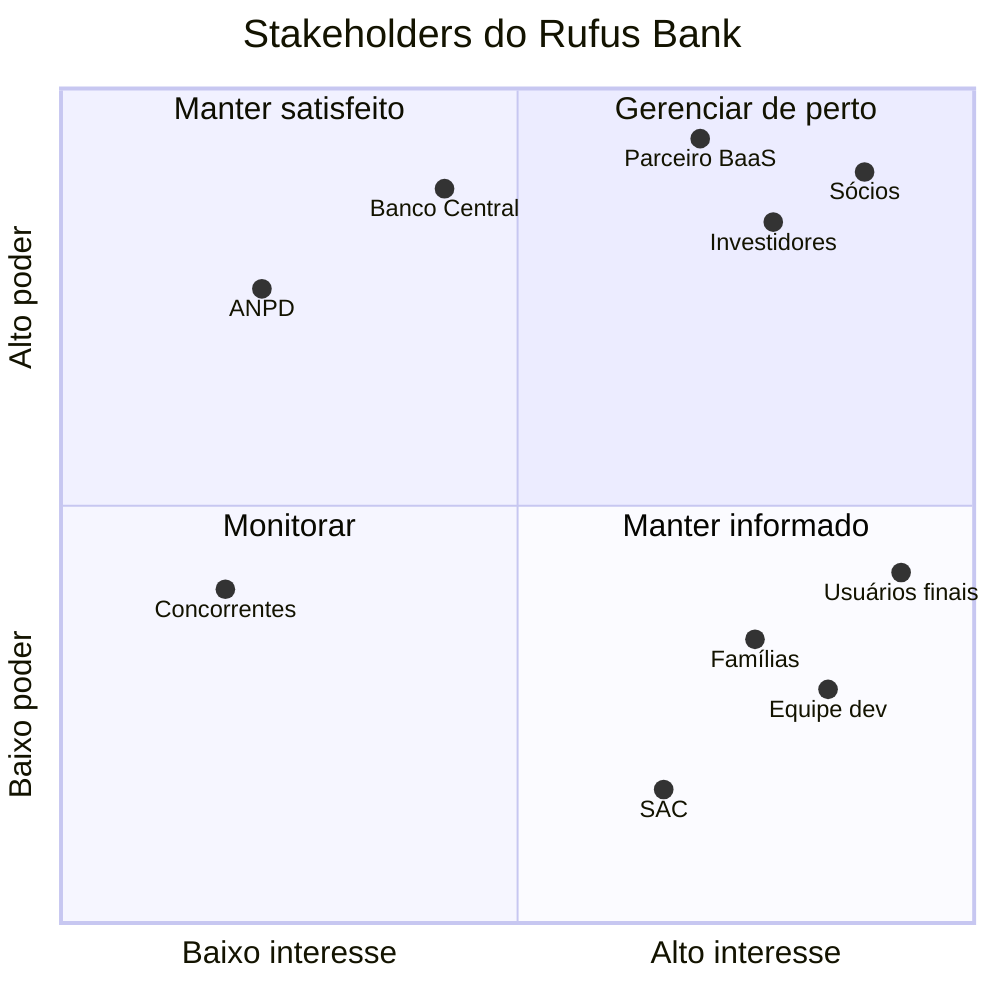

# 3. Mapa de Stakeholders

Os stakeholders foram classificados pela matriz poder x interesse: **poder** é quanto a pessoa ou instituição pode mudar ou barrar o projeto, **interesse** é quanto o resultado a afeta. O quadrante define como o grupo vai se relacionar com cada um.

## Tabela

| Stakeholder | Tipo | Interesse no projeto | Influência sobre o projeto | Poder | Interesse | Estratégia |
| --- | --- | --- | --- | --- | --- | --- |
| Sócios fundadores | Interno | Produto viável, que cresça e dê retorno | Decidem escopo, prioridade e orçamento | Alto | Alto | Gerenciar de perto |
| Investidores | Externo | Retorno do capital, crescimento da base de clientes | Liberam ou cortam o dinheiro. Cobram metas de adesão e custo | Alto | Alto | Gerenciar de perto |
| Parceiro BaaS (instituição autorizada) | Externo | Volume de contas e transações com baixo risco de fraude | Sem ele não existe conta nem Pix. Impõe requisitos de segurança e de prevenção à lavagem de dinheiro | Alto | Alto | Gerenciar de perto |
| Banco Central | Regulador | Inclusão financeira com segurança e sistema estável | Regula o parceiro e o Pix. Uma regra nova pode mudar funcionalidades | Alto | Médio | Manter satisfeito |
| ANPD | Regulador | Cumprimento da LGPD, com atenção a dados de menores e dados biométricos | Pode fiscalizar e multar. Exige comunicação de incidente | Alto | Baixo | Manter satisfeito |
| Usuários finais (Antônio, Camila, Dona Marlene) | Externo | Usar a conta sozinhos e sem cair em golpe | Decidem se o produto dá certo: adesão, uso e avaliação nas lojas | Médio | Alto | Manter informado e envolver nos testes |
| Famílias e cuidadores | Externo | Segurança do parente sem precisar fazer tudo por ele | Indicam ou desaconselham o app. São responsáveis legais e contatos de confiança | Médio | Alto | Manter informado |
| Equipe de desenvolvimento | Interno | Requisitos claros, prazo realista, stack bem decidida | Define o que é tecnicamente possível e em quanto tempo | Médio | Alto | Manter informado e envolver nas decisões |
| Equipe do SAC | Interno | Ferramentas para atender rápido e identificar golpe | Traz as reclamações reais. Influencia as melhorias | Baixo | Alto | Manter informado |
| Concorrentes (bancos e fintechs) | Externo | Manter a base de clientes | Podem copiar a ideia ou baixar preço | Médio | Baixo | Monitorar |

O parceiro BaaS não estava na lista inicial do grupo e foi incluído porque o projeto depende dele para existir (ver item 4 e risco R04).

## Matriz poder x interesse

Os quatro quadrantes, em uma linha cada:

- **Gerenciar de perto** (alto poder, alto interesse): sócios, investidores e parceiro BaaS. Reunião periódica e aprovação das decisões grandes.
- **Manter satisfeito** (alto poder, interesse menor): Banco Central e ANPD. Cumprir as regras e documentar, sem envolver no dia a dia.
- **Manter informado** (poder menor, alto interesse): usuários, famílias, equipe de desenvolvimento e SAC. Testes de uso, comunicação clara e canal de retorno.
- **Monitorar** (poder e interesse menores): concorrentes. Acompanhar lançamentos e preços.
