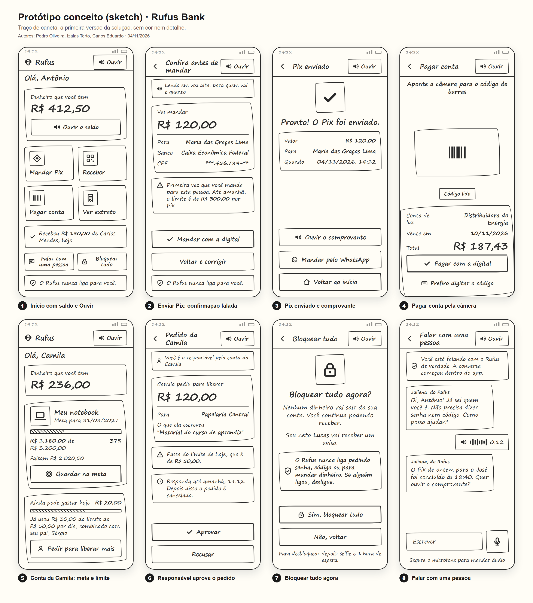
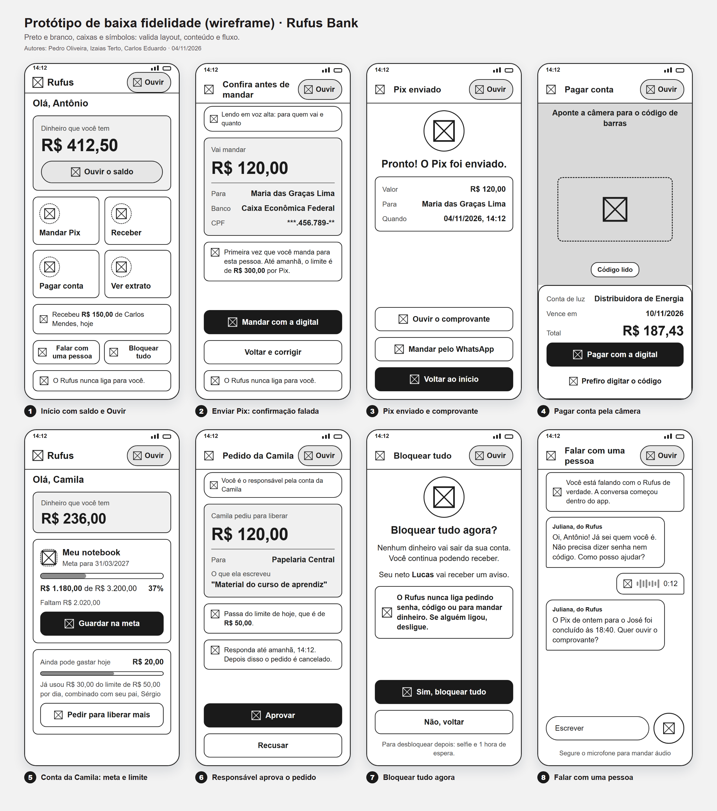
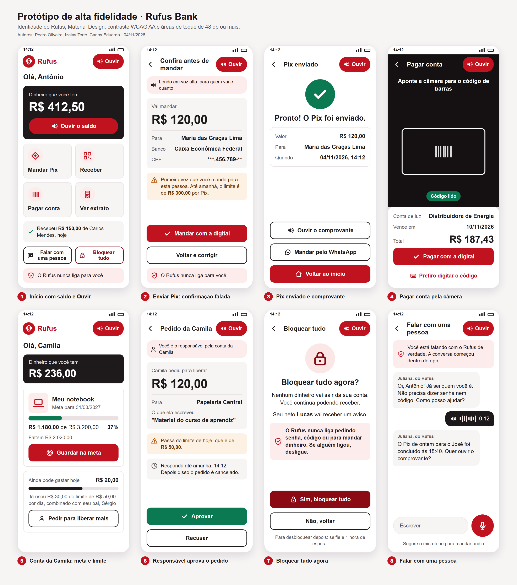

# 2.5 Design de interface

No Rufus a interface é o produto. A interface é a ligação do homem com o software (Aula 05), e o problema do Bloco 1 está nessa ligação: as pessoas já têm conta, mas não conseguem usá-la sozinhas. Por isso o design foi feito antes do código, em três níveis de protótipo, e cada decisão de tela sai de uma persona, de um RF ou de um RNF.

## Os três aspectos que guiaram o projeto

A Aula 05 pede conhecer três aspectos antes de desenhar. No Rufus:

| Aspecto | No Rufus | De onde vem |
| --- | --- | --- |
| Clientes (personas) | Antônio (lê com dificuldade), Camila (17 anos, conta com limite), Dona Marlene (68 anos, medo de errar) | Bloco 1, item 2 |
| Conteúdo (entrada e saída) | Saída: saldo, extrato, nome de quem recebe, comprovante, sempre também em áudio. Entrada: valor, chave Pix, código de barras pela câmera, voz no chat | RF006 a RF013, RF024 |
| Funcionalidades (features) | As 16 funcionalidades F01 a F16, organizadas na taxonomia abaixo | Bloco 1, item 1 |

## Decisões de design

| Decisão | Por quê | Persona | Requisito |
| --- | --- | --- | --- |
| Botão "Ouvir" fixo no topo de toda tela, sempre no mesmo lugar | Quem lê pouco precisa achar o áudio sem procurar | Antônio, Dona Marlene | RF007, RNF09 |
| Linguagem do dia a dia: "Dinheiro que você tem", "Mandar Pix", "Pagar conta" | Jargão ("saldo disponível", "transferência") exclui quem tem pouco letramento financeiro | Todas | Princípio 3 do Bloco 1 |
| Ícone vermelho dentro de um círculo vermelho suave em cada ação | O ícone reduz a leitura; o círculo é o motivo visual da identidade | Antônio | RF006, identidade visual |
| Vermelho só na marca e nos botões; valores em dinheiro sempre em grafite | *Rufus* vem do latim e quer dizer vermelho, ruivo: é a cor da marca. Mas valor vermelho num banco se lê como dinheiro saindo ou saldo negativo | Todas | Identidade visual |
| Tela "Confira antes de mandar" com nome, banco e valor, lida em voz alta automaticamente | Última barreira contra golpe e erro de digitação | Dona Marlene | RF009, risco R01 |
| Aviso "o Rufus nunca liga para você" nas telas de dinheiro e no início do chat | Ataca o golpe da falsa central, o que mais cresceu em 2025 | Antônio, Dona Marlene | RF021 |
| "Bloquear tudo" visível já na tela inicial, em vermelho escuro com cadeado, diferente do vermelho da marca | Quando a pessoa percebe o golpe, cada segundo conta | Dona Marlene | RF020 |
| Câmera que lê o código de barras sozinha, com "Prefiro digitar o código" como saída | Digitar os 47 ou 48 números da linha digitável é a maior barreira para pagar conta | Dona Marlene | RF013, US08 |
| Limite e meta da Camila na própria tela inicial dela | Autonomia com limite visível: ela sabe quanto ainda pode gastar | Camila | RF015, RF017 |
| Responsável decide num cartão só: valor, para quem, o que ela escreveu, prazo | Decisão rápida, sem navegar | Responsável da Camila | RF016, US18 |
| Chat com botão de microfone grande | Antônio prefere falar a escrever | Antônio | RF024, US14 |
| Texto base de 18, valores de dinheiro de 32 a 40, mínimo de 14 só em rótulos curtos | Legibilidade para quem lê com dificuldade | Todas | RNF09 |
| Toda área de toque com 48 dp ou mais (botões de 56, "Ouvir" de 48, ações de 112, microfone de 72) | Mínimo do guia de acessibilidade do Android | Dona Marlene | RNF09 |

## Taxonomia

A taxonomia faz duas coisas (Aula 05): **decompõe o conteúdo** em entidades da interface e **ordena os fluxos** em camadas. No Rufus são três camadas: a seção (o que a pessoa quer fazer), a tela e o passo do fluxo. Toda funcionalidade fica no máximo a um toque de distância da tela inicial.





Fontes: [diagramas/taxonomia-1-dinheiro.mmd](diagramas/taxonomia-1-dinheiro.mmd) e [diagramas/taxonomia-2-apoio-e-seguranca.mmd](diagramas/taxonomia-2-apoio-e-seguranca.mmd). As 9 seções, divididas em duas partes para caber legível.

## Material Design e tipografia

O protótipo segue o Material Design, a abordagem que padroniza temas, formas e linhas e que tem a tipografia como pilar (Aula 05). No app real a fonte é a Roboto do Android; nos protótipos foi usada a Arial, que tem as mesmas proporções e estava instalada na máquina.

| Uso | Tamanho | Peso |
| --- | --- | --- |
| Valor em dinheiro | 32 a 40 | Negrito |
| Título de tela grande ("Bloquear tudo agora?") | 24 | Negrito |
| Título da barra do topo | 20 | Negrito |
| Texto e botões | 18 | Normal e negrito |
| Texto de apoio e avisos | 16 | Normal |
| Rótulos curtos (hora, nome no chat) | 14 a 15 | Normal |

Cores da identidade (`ferramentas/identidade/identidade.json`), todas com contraste medido pela fórmula da WCAG 2.2:

| Par de cores na tela | Contraste | Mínimo AA |
| --- | --- | --- |
| Texto grafite sobre branco (títulos e valores) | 17,2:1 | 4,5:1 |
| Texto branco sobre vermelho (botão "Ouvir" e botão principal) | 6,2:1 | 4,5:1 |
| Texto branco sobre grafite (cartão de saldo) | 17,2:1 | 4,5:1 |
| Rótulo claro sobre grafite ("Dinheiro que você tem") | 12,8:1 | 4,5:1 |
| Ícone vermelho sobre vermelho suave (círculo das ações) | 5,4:1 | 4,5:1 |
| Texto de apoio cinza sobre branco | 7,3:1 | 4,5:1 |
| Texto do aviso laranja sobre fundo laranja claro | 9,0:1 | 4,5:1 |
| Texto branco sobre verde (Aprovar, Pix enviado) | 5,4:1 | 4,5:1 |
| Texto branco sobre vermelho escuro (Sim, bloquear tudo) | 9,8:1 | 4,5:1 |

## Os três níveis de protótipo

Os três níveis saem de uma única descrição de cada tela (`prototipos/src/gerar_prototipos.py`). Assim o wireframe e a tela final nunca divergem de layout: só muda o acabamento.

| Nível | O que é (Aula 05) | Para que usamos |
| --- | --- | --- |
| Protótipo conceito (sketch) | Lápis, caneta e papel: a primeira versão da solução | Discutir a ideia com o grupo e com o PO, sem gastar tempo com cor |
| Baixa fidelidade (wireframe) | O conceito com preto e branco, caixas e símbolos | Validar conteúdo, ordem e fluxo no teste de uso, sem a cor influenciar a opinião |
| Alta fidelidade | Cores, padrão visual e identidade completa | TER, aprovação final do PO e referência para o dev implementar |

### Protótipo conceito



### Baixa fidelidade



### Alta fidelidade



As telas avulsas, em 720 x 1560 pixels, estão em `prototipos/img/` (`alta-01-inicio.png` a `alta-08-falar-com-pessoa.png`, e o mesmo para `baixa-` e `conceito-`).

## Quantos toques cada fluxo leva

O RNF08 promete ver saldo, mandar Pix e pagar boleto em no máximo 3 toques depois do login. A contagem abaixo considera os toques em botões a partir da tela inicial; digitar um valor e pôr a digital no sensor aparecem à parte.

| Fluxo | Toques | Caminho | Dentro do RNF08? |
| --- | --- | --- | --- |
| Ver o saldo | 0 | Já aparece na tela inicial | Sim |
| Ouvir o saldo | 1 | Ouvir o saldo | Sim |
| Pagar conta pela câmera | 2 + digital | Pagar conta, a câmera lê sozinha, Pagar com a digital | Sim |
| Mandar Pix para um contato salvo | 4 + valor + digital | Mandar Pix, escolher o contato, digitar o valor e Continuar, Mandar com a digital | Sim: 3 de navegação mais a confirmação com a digital (ver abaixo) |
| Receber por QR Code | 2 | Receber, Mostrar QR Code | Sim |
| Ver extrato | 1 | Ver extrato | Sim |
| Bloquear tudo agora | 2 | Bloquear tudo, Sim, bloquear tudo | Sim |
| Falar com uma pessoa | 1 | Falar com uma pessoa | Sim |
| Guardar na meta (Camila) | 2 + valor | Guardar na meta, digitar o valor e Confirmar | Sim |
| Responsável aprovar pedido (pai da Camila) | 2 | Tocar na notificação, Aprovar | Sim |

**O Pix tem 4 toques, e o quarto é o "Mandar com a digital"** da tela de conferência. Essa tela é obrigatória por segurança (RF009): é ela que lê em voz alta para quem vai o dinheiro. A decisão foi não cortar a proteção para bater a meta, e sim deixar a regra de contagem explícita no RNF08: contam os toques de navegação; digitar o valor e o toque final de confirmação com a digital não contam. Pela regra, o Pix fica em 3 toques.

Melhoria registrada para depois do MVP: um atalho "Mandar de novo" na tela inicial para as 3 pessoas mais frequentes, que tira mais um toque do caminho.

## TER: Teste de Resposta Emocional

O TER mede, antes de implementar, se o conceito agrada ao público (Aula 05). Ele é feito com o protótipo de alta fidelidade, antes do Sprint 1 de telas.

| Item | Como fazemos |
| --- | --- |
| Quem | 3 pessoas de cada persona: 3 com pouca leitura, 3 adolescentes de 16 ou 17 anos, 3 pessoas com 60 anos ou mais |
| O que mostramos | As 8 telas de alta fidelidade, impressas em tamanho real ou no celular |
| O que perguntamos | "O que você sente olhando esta tela?" e uma escala de 5 rostos (de muito tranquilo a muito nervoso) por tela |
| O que medimos | A palavra espontânea mais repetida (esperado: "fácil", "claro", "seguro") e a média da escala por tela |
| Critério | Tela com média abaixo de "tranquilo" ou com a palavra "confuso" em 2 ou mais pessoas volta para o protótipo |
| Quem decide | O PO, que mantém o backlog priorizado |

## Teste de uso (RNF08)

| Item | Como fazemos |
| --- | --- |
| Quando | A cada sprint que entrega tela nova, com o protótipo de baixa fidelidade antes e com o app depois |
| Quem | 5 pessoas do perfil das personas por rodada (Nielsen: 5 usuários acham a maior parte dos problemas) |
| Tarefas | Ver quanto tem, mandar R$ 20,00 para um contato, pagar uma conta de luz de exemplo, bloquear a conta |
| Meta | Pelo menos 4 das 5 pessoas pagam o boleto sem ajuda em até 3 minutos (RNF08) |
| Registro | Tempo de cada tarefa, número de toques, onde a pessoa hesitou e frases ditas em voz alta |
| Saída | Problema encontrado vira item do backlog. A Definition of Done das telas exige a rodada aprovada (Bloco 9) |

## Como gerar de novo

```
python -I bloco-2-requisitos/prototipos/src/gerar_prototipos.py
python -I ferramentas/diagramas/gerar.py bloco-2
```

O primeiro comando gera as 24 telas e as 3 pranchas com o Chrome headless. O segundo gera a taxonomia. Os dados das telas são fictícios e seguem as personas e as regras do projeto: limite de R$ 300,00 para destinatário novo nas primeiras 24 horas, R$ 50,00 por dia na conta da Camila, prazo de 24 horas para o responsável decidir e desbloqueio com selfie e 1 hora de espera.
