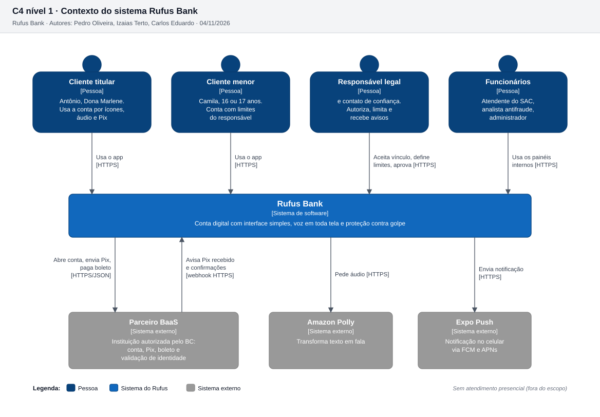
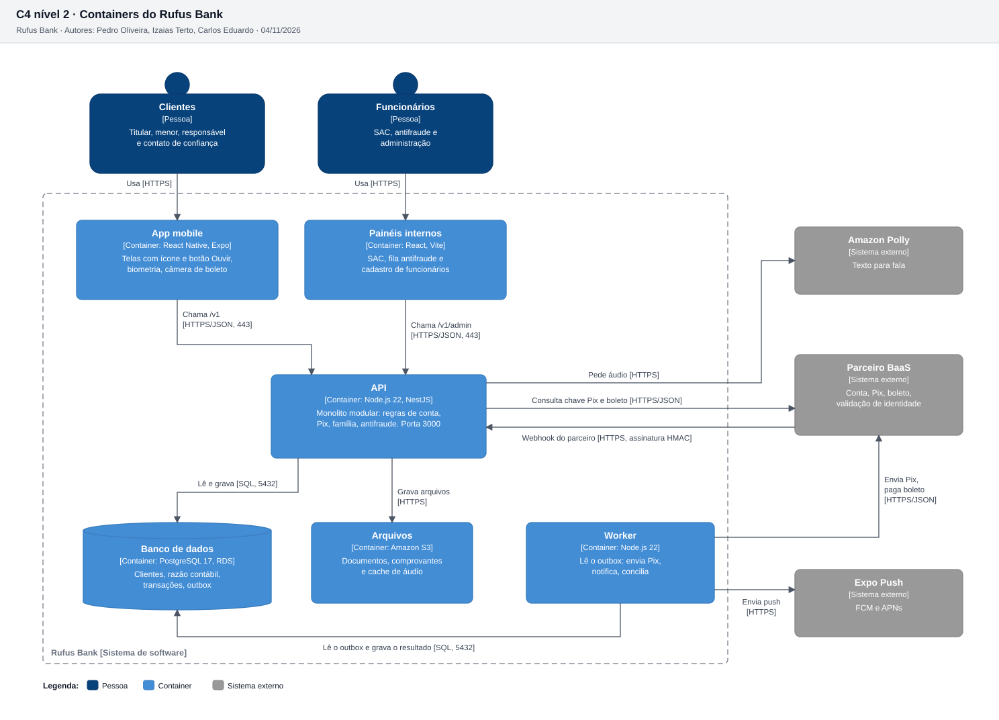
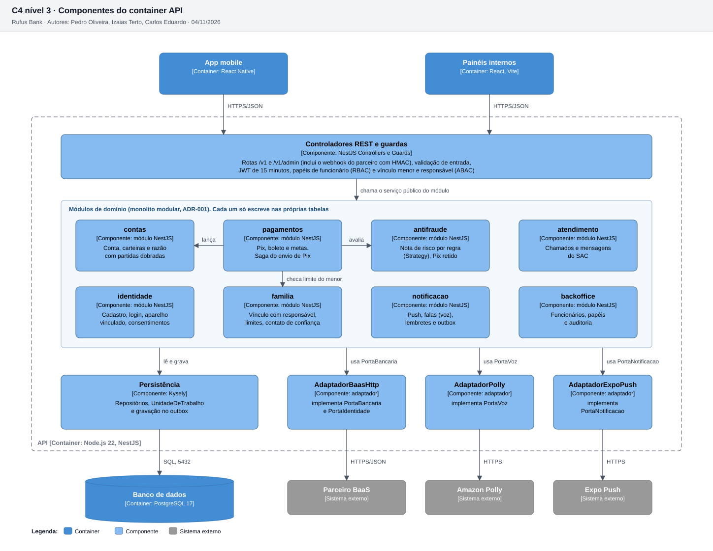

# 3.2 Modelo C4

Os 4 níveis do C4, do mais amplo ao mais detalhado. Cada nível aproxima o zoom de uma parte do nível anterior: o sistema (nível 1) é aberto em containers (nível 2), o container API é aberto em componentes (nível 3) e o componente crítico ServicoEnvioPix é aberto em código (nível 4).

Cores na convenção do C4: azul escuro para pessoas, azul para o que o Rufus constrói, azul claro para componentes e cinza para sistemas externos. Toda seta diz o que trafega e o protocolo, entre colchetes.

Os diagramas são gerados por `python ferramentas/diagramas/gerar.py bloco-3` a partir das fontes em [diagramas/](diagramas/). Título, autores e data entram sozinhos, a partir de `projeto.json`.

## Nível 1 · Contexto

**O que mostra.** Quem usa o Rufus e com quais sistemas de fora ele conversa. É a visão para quem não é técnico: o Rufus é uma caixa só.

**Como ler.** No alto estão as quatro pessoas, que são os atores humanos do Documento de Visão agrupados. Clientes titular e menor usam o app. Responsável e contato de confiança aparecem juntos porque os dois só reagem ao que o cliente faz (aceitar, limitar, receber aviso). Funcionários (atendente, analista antifraude e administrador) usam os painéis. Embaixo estão os três sistemas externos. O parceiro BaaS tem duas setas, porque o Rufus chama o parceiro e o parceiro também chama o Rufus por webhook quando um Pix chega.

**Decisões que aparecem aqui.**
- Conta, Pix e boleto ficam no parceiro BaaS, e o Rufus não tem core bancário próprio (Bloco 1, fora do escopo, e ADR-002).
- A voz vem de um serviço externo, e não do celular (ADR-011).
- Não há canal presencial (fora do escopo do Bloco 1).

## Nível 2 · Containers

**O que mostra.** As peças que rodam separadas e se comunicam pela rede: dois front-ends, a API, o worker, o banco e o armazenamento de arquivos.

**Como ler.**
- O **app mobile** e os **painéis internos** só falam com a **API**, por HTTPS na porta 443 do balanceador. Nenhum front-end acessa banco ou parceiro direto.
- A **API** recebe as requisições na porta 3000 do container, grava no **PostgreSQL** (porta 5432) e no **S3**. Ela chama o parceiro só nas consultas síncronas: dados do recebedor do Pix e do boleto, que o cliente precisa ver antes de confirmar.
- O **worker** faz o trabalho que não precisa segurar o cliente esperando. Ele lê o outbox, envia o Pix e o pagamento de boleto ao parceiro e manda os push.
- O parceiro avisa a API por **webhook** assinado com HMAC. A API confere a assinatura antes de aceitar.

**Decisões que aparecem aqui.**
- API e worker são dois containers do **mesmo código**, o monolito modular do ADR-001. Separar em dois processos deixa o envio ao parceiro fora da requisição do cliente.
- Há um **único banco**, coerente com o monolito. Com microsserviços seria um banco por serviço, e essa opção foi descartada no ADR-001.
- A fila é a tabela de outbox no próprio banco (ADR-008). Por isso não aparece fila separada.
- Os painéis são um container próprio no desenho, mas são servidos pela API em `/admin` (ADR-012).

## Nível 3 · Componentes da API

**O que mostra.** O que existe dentro do container API: a camada HTTP, os 8 módulos de domínio e a camada de infraestrutura com as portas e adaptadores.

**Como ler, de cima para baixo.**
1. **Controladores REST e guardas** recebem a requisição, validam a entrada, conferem o JWT e aplicam o controle de acesso: papéis de funcionário (RBAC) e vínculo entre menor e responsável (ABAC). O webhook do parceiro também entra por aqui, com conferência do HMAC.
2. Os **módulos de domínio** têm as regras. Cada um só escreve nas próprias tabelas e expõe um serviço público. As setas mostram as dependências principais do Pix: `pagamentos` lança no razão de `contas`, pede a nota de risco ao `antifraude` e confere o limite do menor em `familia`.
3. A **persistência** e os **adaptadores** ficam embaixo. Os módulos não conhecem o parceiro, o Polly nem o Expo: dependem só das interfaces `PortaBancaria`, `PortaIdentidade`, `PortaVoz` e `PortaNotificacao`.

**Decisões que aparecem aqui.**
- **Portas e adaptadores** (ADR-002): trocar de parceiro BaaS significa escrever um adaptador novo, sem tocar nos módulos. Isso mitiga o risco R04. No localhost os adaptadores reais dão lugar a adaptadores falsos.
- **Fronteira de módulo** (ADR-001): a regra "cada módulo só escreve nas próprias tabelas" é verificada por lint de dependência no pipeline.
- O Pix depende de três módulos, mas tudo acontece numa transação local do banco, pela UnidadeDeTrabalho. Isso garante o RNF11 (zero Pix duplicado) sem transação distribuída.

## Nível 4 · Código do componente crítico ServicoEnvioPix

**Por que este componente.** O envio de Pix é a operação que move dinheiro para fora, envolve um sistema externo que pode falhar e é o alvo dos golpes (risco R01). Um erro aqui é o pior erro possível para o produto.

**Como funciona `iniciar(contaId, pedido, chaveIdempotencia)`.**
1. Procura uma transação com a mesma chave de idempotência (`TransacaoRepository.buscarPorIdempotencia`). Se existir, devolve a mesma, sem débito novo (RNF11, US07).
2. Cria o `PixEnvio` e pede a nota ao `MotorAntifraude`, que soma as notas de cada `RegraRisco`. Com nota 70 ou mais a transação fica RETIDA (RF026).
3. Dentro da `UnidadeDeTrabalho`, numa única transação do banco: grava a transação PENDENTE, reserva o saldo com dois lançamentos (`reservarSaldo`) e publica o evento no outbox.
4. Depois o worker envia o Pix pela `PortaBancaria`. Se o parceiro recusar, `compensar` estorna a reserva. É a saga orquestrada do Bloco 3 (padrões de design) e do diagrama de sequência 3 do Bloco 4.

**Notação e decisões.**
- `PortaBancaria`, `RegraRisco` e os repositórios são **interfaces**. A seta tracejada com triângulo vazio é **realização**: `AdaptadorBaasHttp` implementa `PortaBancaria`, e cada regra implementa `RegraRisco` (padrão Strategy).
- `MotorAntifraude` tem as regras por **agregação** (losango vazio). As regras existem e são testadas sozinhas, e o motor recebe a lista por injeção de dependência. Não é composição porque a vida das regras não depende do motor.
- `Transacao` é **abstrata** e `PixEnvio` a especializa (herança). Os atributos de `Transacao` são **protegidos** (`#`) porque as subclasses os usam. Os campos internos do serviço são **privados** (`-`).
- `AdaptadorBaasHttp` guarda um `CircuitBreaker`. Quando o parceiro falha em sequência, o disjuntor para de chamar por 30 s (padrão Circuit Breaker).
