# Bloco 4 · Diagramas UML

São 9 diagramas UML, que cobrem os 6 tipos pedidos no enunciado, mais 2 processos de negócio em BPMN como complemento. Os diagramas grandes estão divididos em partes, para o texto continuar legível no PDF impresso (cerca de 7 pt ou mais). Cada imagem tem título, autores e data no cabeçalho e segue o modelo de domínio ([05-modelo-de-dominio.md](../bloco-3-arquitetura/05-modelo-de-dominio.md)) e as rotas ([06-rotas-da-api.md](../bloco-3-arquitetura/06-rotas-da-api.md)) do Bloco 3, com os mesmos nomes.

| # | Diagrama | Tipo exigido | Requisitos cobertos |
| --- | --- | --- | --- |
| 1 | [Casos de uso](#1-casos-de-uso) | Casos de Uso | RF001 a RF030 |
| 2 | [Classes do domínio](#2-classes) | Classes (mín. 10) | 23 classes, modelo de domínio inteiro |
| 3 | [Sequência: autenticação](#3-sequência-1-autenticação) | Sequência 1 de 3 | RF003, RF004, RF005, RNF05 |
| 4 | [Sequência: Pix com sucesso](#4-sequência-2-envio-de-pix-caminho-feliz) | Sequência 2 de 3 | RF008, RF009, RF019, RF026, RNF02 |
| 5 | [Sequência: erro crítico no Pix](#5-sequência-3-erro-crítico-falha-no-parceiro-e-estorno) | Sequência 3 de 3 | RNF11, US07, saga do Bloco 3 |
| 6 | [Componentes](#6-componentes) | Componentes | ADR-001, ADR-002 |
| 7 | [Deployment](#7-deployment) | Deployment | RNF03, ADR-009, ADR-013 |
| 8 | [Atividade: abertura de conta](#8-atividade-1-abertura-de-conta) | Atividades 1 de 2 (negócio) | RF001, RF002, RF014, US09 |
| 9 | [Atividade: análise antifraude](#9-atividade-2-análise-antifraude-de-pix-retido) | Atividades 2 de 2 (administrativo) | RF026, RF027, US16 |
| 10 | [Processos de negócio em BPMN](#10-processos-de-negócio-em-bpmn) | Complemento (Aula 02) | RF008, RF014, RF026, RF027, US09 |

Gerar de novo: `python ferramentas/diagramas/gerar.py bloco-4`. As fontes ficam em [diagramas/](diagramas/): `.mmd` para Mermaid (classes, sequência e atividades) e `.svg.py` para casos de uso, componentes, deployment e BPMN, que o Mermaid não desenha na notação padrão. As imagens ficam em `diagramas/img/`, em SVG (para o PDF) e PNG (para os slides).

---

## 1. Casos de uso

O diagrama está em 2 partes, para o texto continuar legível impresso: a parte 1 traz o cliente, os sistemas externos e todos os «include» e «extend»; a parte 2 traz os atores de gestão.

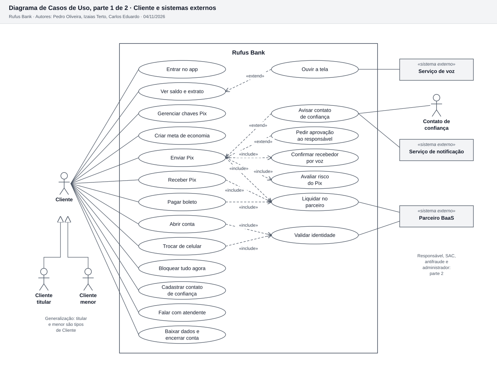

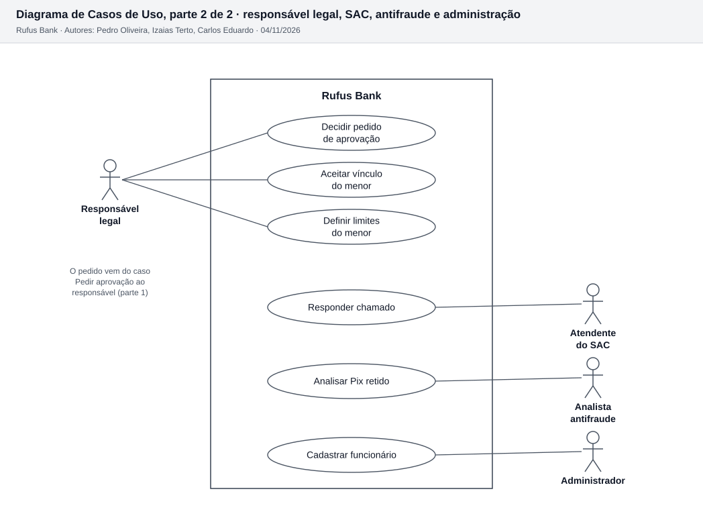

**O que mostra.** Tudo que cada ator faz no Rufus. A fronteira é o sistema Rufus Bank: dentro dela ficam os casos de uso, fora ficam os atores.

**Atores.** À esquerda, o **Cliente**, que é um ator abstrato. **Cliente titular** e **Cliente menor** são especializações dele (generalização, seta com triângulo vazio): os dois fazem tudo que o Cliente faz, e o menor tem limites. À direita ficam os atores que reagem ou administram: contato de confiança, responsável legal, atendente do SAC, analista antifraude e administrador. Os três sistemas externos (serviço de voz, serviço de notificação e parceiro BaaS) aparecem como atores com o estereótipo «sistema externo».

**Relações entre casos de uso.**
- **«include»** (sempre acontece): Enviar Pix sempre inclui Confirmar recebedor por voz (RF009), Avaliar risco do Pix (RF026) e Liquidar no parceiro. Abrir conta e Trocar de celular sempre incluem Validar identidade (RF002, RF005). Receber Pix e Pagar boleto também incluem Liquidar no parceiro. A seta sai do caso base e aponta para o incluído.
- **«extend»** (acontece só sob condição): Ouvir a tela estende Ver saldo e extrato, quando o cliente toca em "Ouvir" (RF007). Avisar contato de confiança estende Enviar Pix quando a movimentação foge do padrão (RF018). Pedir aprovação ao responsável estende Enviar Pix quando o menor passa do limite (RF016). A seta sai da extensão e aponta para o caso base.
- **Generalização** entre atores: titular e menor herdam todos os casos do Cliente.

**Por que o Administrador aparece.** O RF030 e a US22 pedem cadastro de funcionários com papel, por isso ele é um ator.

## 2. Classes





**O que mostra.** As 23 classes do domínio com atributos tipados, métodos e visibilidade, e todas as relações da tabela de relações do modelo de domínio. Para o texto continuar legível impresso, o diagrama está em 4 partes, uma por grupo de módulos (A identidade, B família, atendimento e backoffice, C contas e metas, D transações e antifraude). Uma classe que pertence a outra parte aparece só com o nome e o estereótipo «parte X», para a relação continuar visível. As 27 relações do modelo de domínio estão todas desenhadas; as duas que cruzam grupos aparecem nas duas partes.

**Visibilidade.** Atributos privados (`-`): o estado só muda pelos métodos públicos (`+`), por exemplo `Conta.bloquearTudo()` e `VinculoResponsavel.definirLimites(diario: Long, mensal: Long)`. Em `Transacao` os atributos são protegidos (`#`) porque as subclasses usam esses campos.

**Tipos.** Dinheiro sempre em `Long` com sufixo `Centavos`, porque ponto flutuante perde centavo. Datas e horas em `Instant` (UTC). Datas sem hora em `LocalDate`. Identificadores em `UUID`. Os estados são enumerações, como `StatusTransacao`.

**As três decisões que a arguição costuma perguntar.**

| Onde | Relação usada | Por que essa e não outra |
| --- | --- | --- |
| `Transacao` e `PixEnvio`, `PixRecebimento`, `PagamentoBoleto`, `MovimentoMeta` | **Herança** (generalização) | Um Pix **é uma** transação. Todos os subtipos compartilham o mesmo ciclo de vida (`StatusTransacao`, padrão State), a idempotência e os lançamentos no razão. Com composição (a transação "teria um" Pix), cada subtipo repetiria o ciclo de vida e as regras de estorno |
| `Chamado` e `MensagemChamado` | **Composição** (losango cheio) | A mensagem não existe sem o chamado: se o chamado for apagado por anonimização, as mensagens vão junto. A mesma regra vale para `Transacao` e `Lancamento` (um lançamento sem transação quebraria a soma zero das partidas dobradas) e para `Cliente` com `Dispositivo`, `Credencial`, `Consentimento` e `ContatoConfianca` |
| `Conta` e `ChavePix` | **Agregação** (losango vazio) | A chave Pix pertence à conta, mas pode ser excluída e cadastrada de novo sem afetar a conta (RF011). A conta continua existindo sem nenhuma chave |

**Outras relações.**
- `Cliente` tem duas associações com `VinculoResponsavel`, com papéis diferentes: como **menor** (0 ou 1 vínculo) e como **responsável** (0 ou mais vínculos, porque um pai pode ter mais de um filho).
- `Transacao` gera **2 ou mais** `Lancamento`: as partidas dobradas exigem pelo menos um débito e um crédito (ADR-007).
- `Meta` tem a própria `Carteira` por composição: o dinheiro guardado na meta é uma carteira separada no razão.

**Do diagrama ao banco.** Alguns atributos mudam de forma no banco por segurança. Por exemplo, `cpf` vira `cpf_cifrado` e `cpf_hash`. A tabela com essas diferenças está no fim do modelo de domínio do Bloco 3.

## 3. Sequência 1 · Autenticação

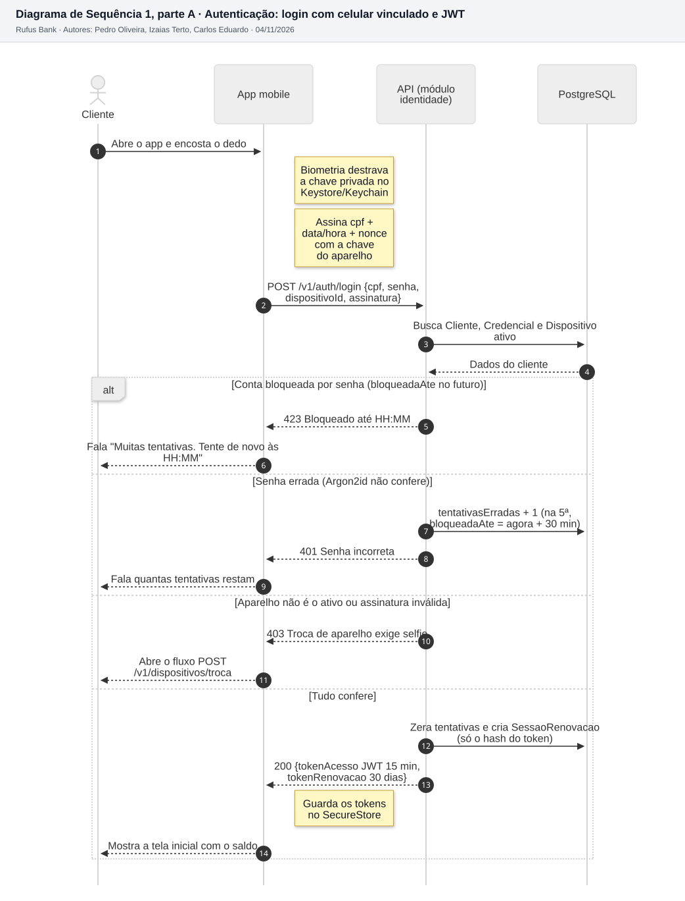

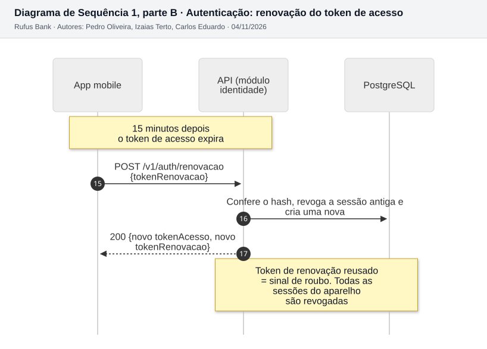

**O que mostra.** O login com celular vinculado (ADR-010) e a renovação do token.

**Como ler.**
- Passos 1 e 2 (e as notas): a biometria destrava, no próprio celular, a chave privada que fica no Keystore ou no Keychain. O app assina os dados do login com essa chave. A digital nunca sai do celular.
- O `alt` mostra os quatro resultados possíveis da mesma requisição:
  - conta bloqueada por excesso de tentativas (423);
  - senha errada (401), com o bloqueio de 30 minutos na 5ª tentativa (RF004);
  - aparelho diferente do vinculado (403), que leva à troca de aparelho com selfie (RF005);
  - sucesso (200), com JWT de 15 minutos e token de renovação de 30 dias (RNF05).
- Na parte B (passos 15 a 17), a renovação troca o token a cada uso. Se um token de renovação já usado aparece de novo, é sinal de roubo e todas as sessões do aparelho são revogadas.

## 4. Sequência 2 · Envio de Pix, caminho feliz

A sequência está em 3 partes (A, B e C), com a numeração dos passos continuando de uma para a outra. O MotorAntifraude aparece como chamada interna da API (passo 13), porque é um componente dela (ADR-001).

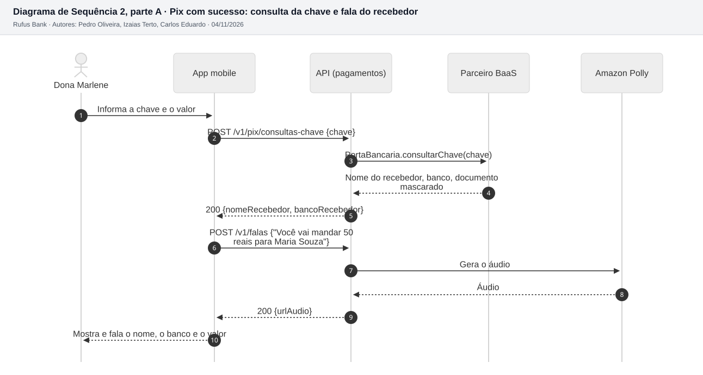

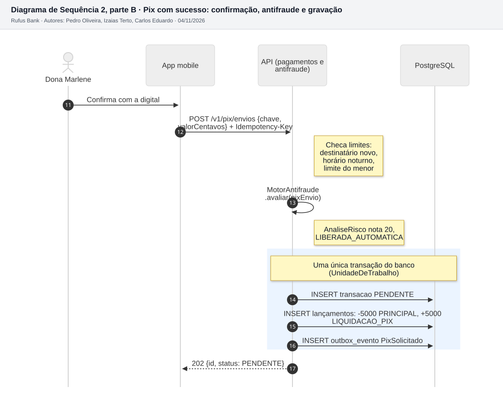

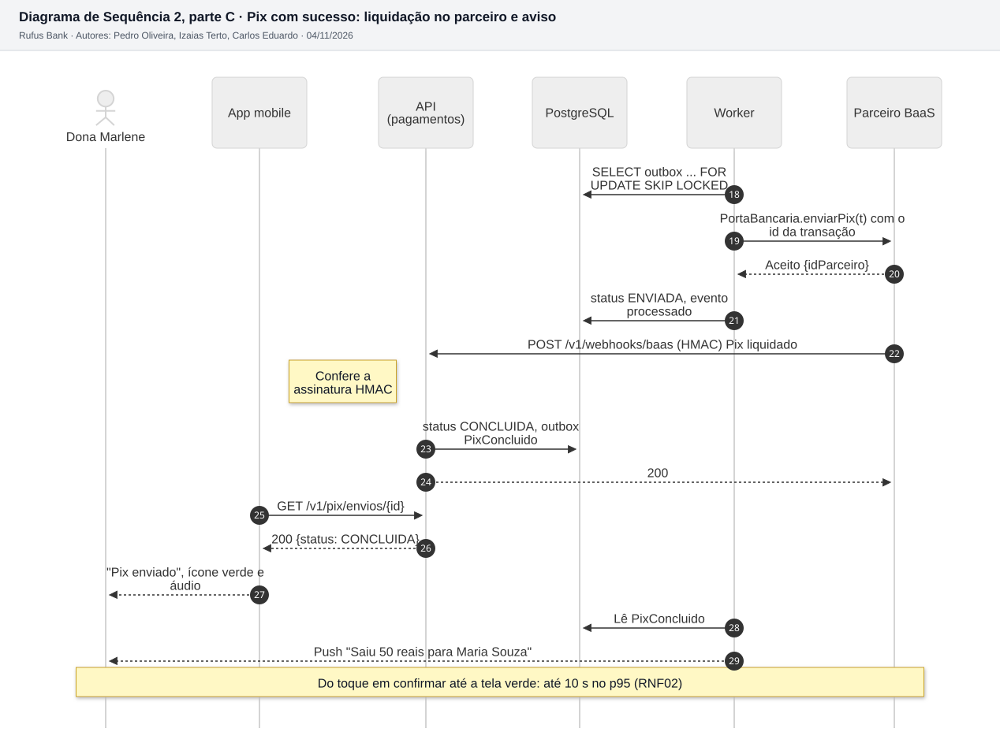

**O que mostra.** O fluxo principal do produto, com a Dona Marlene enviando 50 reais.

**Como ler, em quatro partes.**
1. **Antes de confirmar** (1 a 10, parte A): a API consulta o recebedor no parceiro e gera o áudio. O app mostra e fala o nome, o banco e o valor (RF009). É a barreira contra golpe e contra erro de digitação.
2. **Confirmação** (11 a 17, parte B): com a digital, o app envia o Pix com `Idempotency-Key`. A API confere os limites (RF019, limite do menor), pede a nota ao antifraude (RF026) e, numa única transação do banco (área azul), grava a transação, reserva o saldo com dois lançamentos e publica o evento no outbox. A resposta é 202: o Pix foi aceito para processamento.
3. **Envio ao parceiro** (18 a 24, parte C): o worker lê o outbox e envia. O parceiro confirma a liquidação por webhook assinado.
4. **Retorno ao cliente** (25 a 29, parte C): o app consulta a situação e mostra a tela verde com áudio, e o worker manda o push.

**Por que o 202 e o worker.** Se a API esperasse o parceiro dentro da requisição, uma lentidão do parceiro prenderia conexões e o clique repetido viraria risco de duplicidade. O cliente vê o resultado em até 10 s no p95 (RNF02).

## 5. Sequência 3 · Erro crítico: falha no parceiro e estorno

A sequência está em 3 partes, com a numeração continuando: A (passos 1 a 8), B (9 a 17) e C (18 a 24).

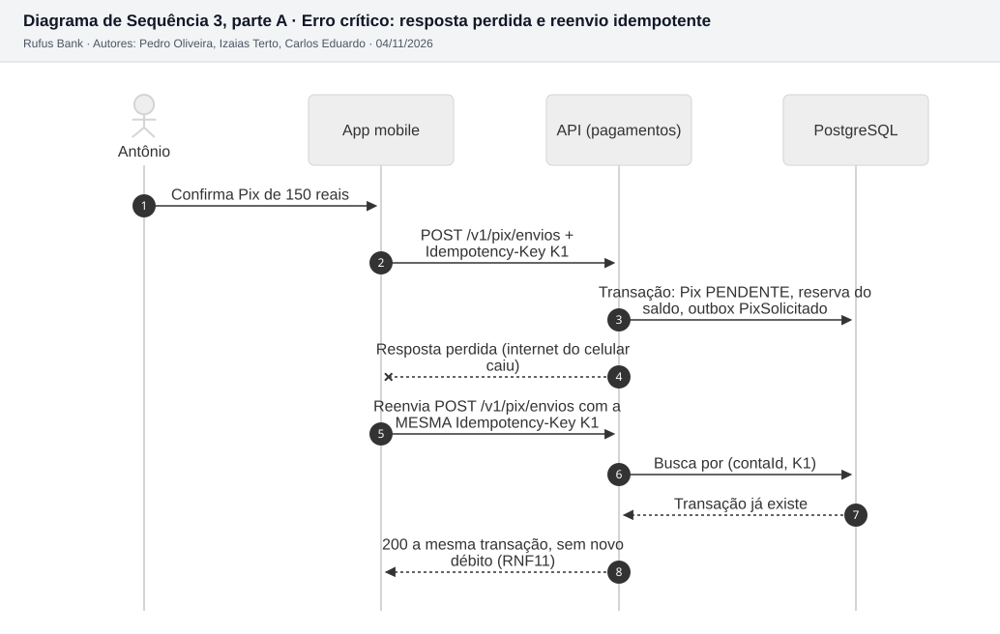

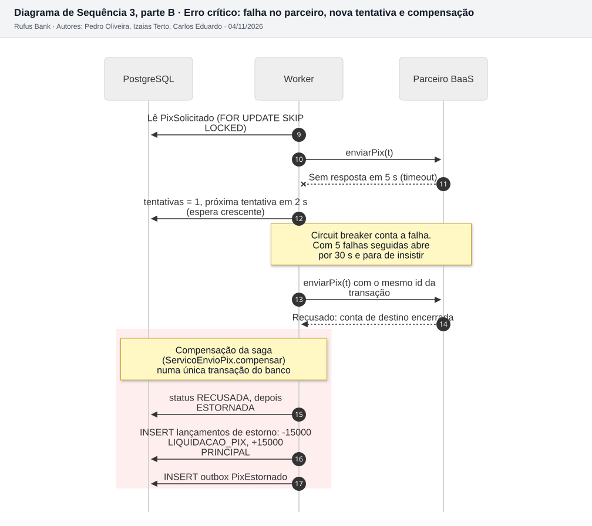

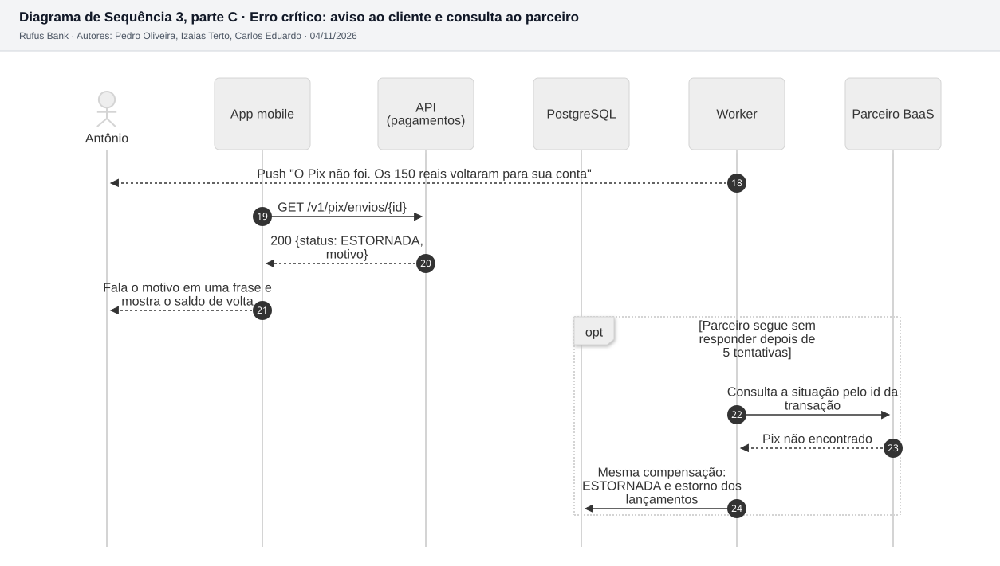

**O que mostra.** O cenário de erro mais grave: dinheiro reservado e o parceiro falhando no meio. São dois problemas encadeados.

**Problema 1, resposta perdida** (passos 2 a 8). A internet do Antônio cai depois que a API já gravou o Pix (a seta com "x" é a mensagem perdida). O app reenvia com a **mesma** `Idempotency-Key`, a API encontra a transação existente e devolve a mesma, **sem novo débito**. É o que garante o RNF11 e a US07.

**Problema 2, falha e recusa no parceiro** (passos 9 a 21).
- O worker não recebe resposta em 5 s, registra a tentativa e agenda outra com espera crescente.
- O circuit breaker conta a falha. Com 5 falhas seguidas ele para de chamar o parceiro por 30 s, para não piorar uma queda.
- Na segunda tentativa, com o mesmo id de transação (o parceiro não duplica), o parceiro recusa.
- A **compensação da saga** (área vermelha), numa única transação do banco, marca a transação como RECUSADA e depois ESTORNADA, grava os lançamentos de estorno, que devolvem os 150 reais à carteira principal, e publica `PixEstornado`.
- O Antônio recebe push e áudio com o motivo em uma frase.

**O `opt` no fim.** Se o parceiro continuar sem responder depois de 5 tentativas, o worker consulta a situação pelo id. Se o Pix não existe no parceiro, aplica a mesma compensação. O dinheiro do cliente nunca fica preso sem resposta.

## 6. Componentes

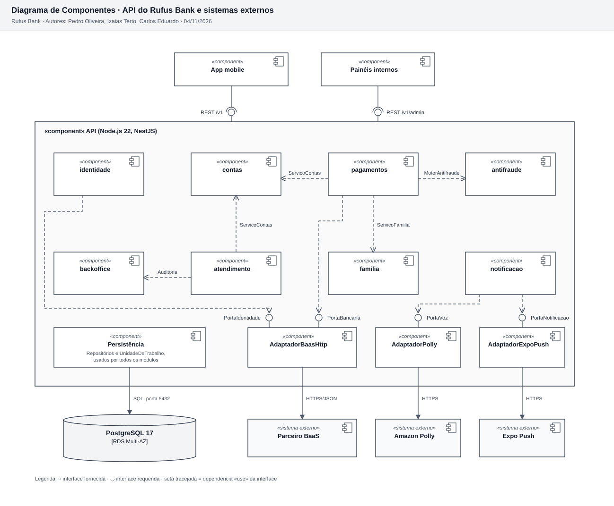

**O que mostra.** Os componentes da API, as interfaces que cada um fornece e requer, e os sistemas externos.

**Notação UML 2.**
- Componente: retângulo com o ícone de componente no canto.
- Interface fornecida: círculo, o "pirulito".
- Interface requerida: meia-lua, o "soquete".
- Dependência de uma interface: seta tracejada.

**Como ler.**
- No alto, a API fornece as interfaces **REST /v1**, usada pelo app, e **REST /v1/admin**, usada pelos painéis. O soquete de cada front-end se encaixa no pirulito da API.
- Dentro da API, os 8 módulos. Cada seta tracejada leva o nome da interface pública usada: `ServicoContas`, `MotorAntifraude`, `ServicoFamilia` e `Auditoria`.
- Embaixo, cada adaptador **fornece** uma porta: `AdaptadorBaasHttp` fornece `PortaBancaria` e `PortaIdentidade`, `AdaptadorPolly` fornece `PortaVoz` e `AdaptadorExpoPush` fornece `PortaNotificacao`. Os módulos **requerem** essas portas: `identidade` requer `PortaIdentidade`, `pagamentos` requer `PortaBancaria` e `notificacao` requer `PortaVoz` e `PortaNotificacao`.

**Decisão que o diagrama prova.** Nenhum módulo depende de um sistema externo diretamente: todos dependem de uma interface nossa. Trocar o parceiro BaaS (risco R04) é trocar um componente da última linha (ADR-002).

## 7. Deployment

O diagrama está em 2 partes: a produção na AWS (parte 1) e o desenvolvimento local com a homologação (parte 2).

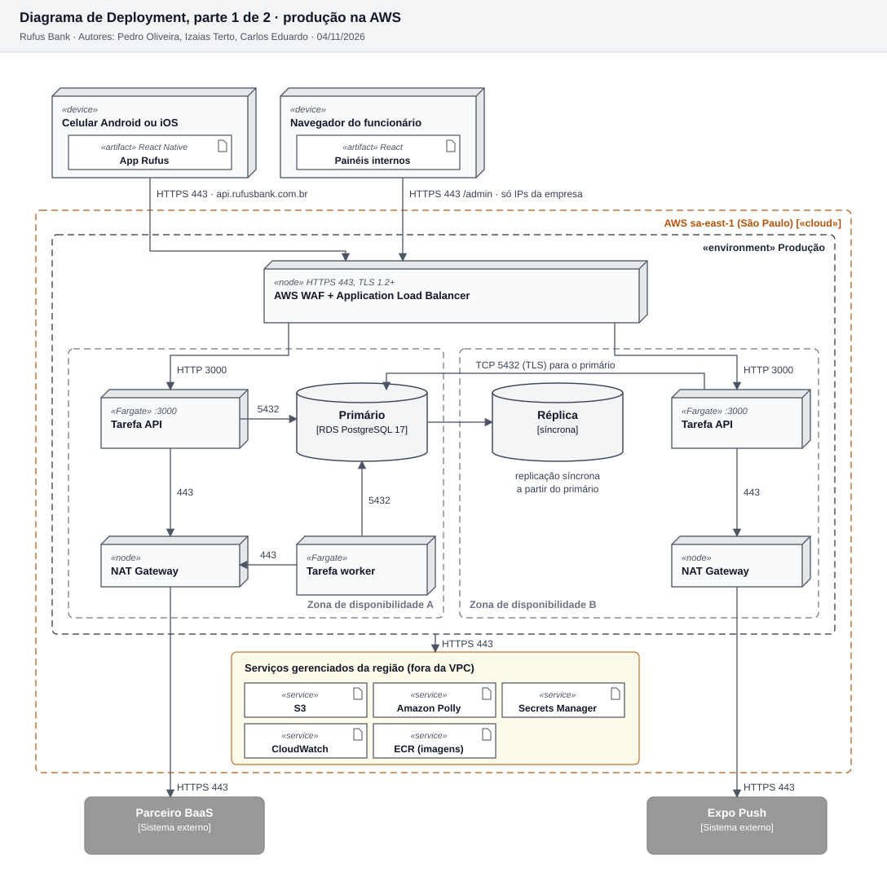

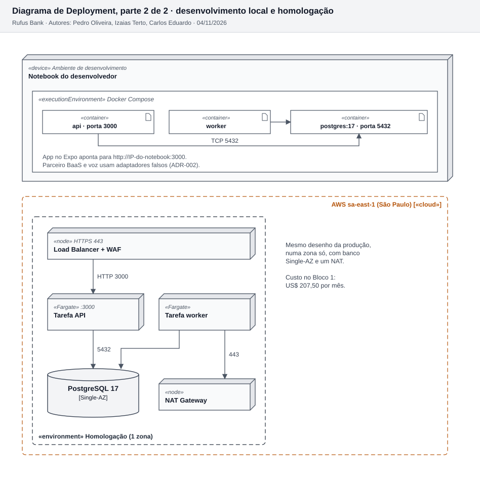

**O que mostra.** Onde cada peça roda nos três ambientes, com protocolos e portas.

**Desenvolvimento** (no alto à direita): tudo no notebook com Docker Compose. A API fica na porta 3000 e o PostgreSQL 17 na 5432, com custo zero de nuvem (Bloco 1). O app no Expo aponta para o IP do notebook, e o parceiro e a voz usam adaptadores falsos.

**Produção** (AWS sa-east-1, duas zonas de disponibilidade):
- O celular e o navegador chegam ao **WAF e Application Load Balancer** por HTTPS na porta 443, com TLS 1.2 ou superior. O caminho `/admin` só aceita IPs da empresa (ADR-012).
- O balanceador distribui por HTTP na porta 3000 para uma **tarefa da API em cada zona**. Se uma zona cair, a outra continua atendendo.
- O **PostgreSQL primário** fica na zona A, com **réplica síncrona** na zona B (RDS Multi-AZ). As duas tarefas da API e o worker usam o primário pela porta 5432 com TLS. Se o primário cair, o RDS promove a réplica.
- Cada zona tem o próprio **NAT Gateway** para sair à internet na porta 443 (parceiro BaaS e Expo Push). Assim a saída não depende de uma zona só.
- S3, Polly, Secrets Manager, CloudWatch e ECR são serviços gerenciados da região, acessados por HTTPS.

**Homologação** (à direita): o mesmo desenho em uma zona só, com banco Single-AZ e um NAT. É mais barato e suficiente para testar antes de publicar.

**Como isso garante os 99,9%** (RNF03, até 43 minutos fora do ar por mês): não há ponto único de falha na produção. São duas tarefas em zonas diferentes, banco com failover automático e NAT por zona. São as mesmas peças custeadas no Bloco 1.

## 8. Atividade 1 · Abertura de conta

O diagrama está em 3 partes ligadas por **conectores** (círculo com letra, a notação UML para continuar o fluxo em outro lugar): A (cadastro e validação do adulto), B (ramo do menor, conector **M**) e C (abertura da conta, fim comum, que recebe o adulto pelo conector **P** e o menor pelo conector **V**).




**O que mostra.** O processo de negócio principal: como uma pessoa vira cliente, incluindo o caso do menor.

**Notação.** Círculo cheio é o início. Círculo com borda é o fim. Losango é decisão, com cada saída rotulada. A barra preta é **fork** (divide em atividades paralelas) ou **join** (espera todas terminarem). Entre parênteses no começo de cada ação está a partição: quem executa (Cliente, Rufus, Parceiro BaaS ou Responsável).

**Como ler.**
- Menos de 16 anos encerra na hora. Ninguém abaixo dessa idade é cliente.
- Adulto: documento, selfie e consentimentos, depois a validação no parceiro. Se a foto for recusada, o Rufus fala o motivo e o cliente volta a enviar (o laço à esquerda, US01).
- Menor de 16 ou 17 anos: depois dos consentimentos, um **fork** abre dois caminhos em paralelo:
  - o parceiro valida a identidade do menor;
  - o responsável recebe o convite, valida a própria identidade e aceita os termos.
- O **join** só segue quando os dois terminam. Se o responsável não aceitar em 7 dias, o pedido é cancelado e os dados são apagados (US09, LGPD).
- O fim é igual para todos: o parceiro abre a conta, o Rufus cria a carteira principal no razão, o cliente cria a senha e o celular é vinculado (RF003, RF005).

## 9. Atividade 2 · Análise antifraude de Pix retido

O diagrama está em 2 partes ligadas pelo conector **R**: A (retenção, análise e liberação) e B (recusa e bloqueio).



**O que mostra.** O processo administrativo mais importante: o que acontece com um Pix suspeito até a decisão humana (RF026, RF027, US16).

**Como ler.**
- Com nota 70 ou mais o Pix fica RETIDA. Um **fork** avisa o cliente e, ao mesmo tempo, coloca o Pix na fila do painel. O **join** junta os dois antes de o analista começar.
- O analista vê os motivos da nota, o histórico e o destinatário. Se precisar de mais informação, fala com o cliente pelo chat do app e volta à análise (o laço à direita).
- **Liberar**: a decisão fica gravada com auditoria (RNF14), o worker envia o Pix pelo outbox e o cliente é avisado.
- **Recusar**: a decisão fica gravada com auditoria e o valor volta à carteira principal. Se houver indício de golpe ou de conta tomada, a conta é bloqueada e o contato de confiança é avisado. Nos dois casos o cliente é orientado a falar com o SAC pelo app, nunca por telefone (RF021).

## 10. Processos de negócio em BPMN

Complemento aos 6 diagramas UML obrigatórios, com o conteúdo da Aula 02 da disciplina. Os diagramas de atividades (seções 8 e 9) mostram o fluxo **dentro** do sistema; o BPMN mostra o processo de negócio **entre os participantes**: cliente, Rufus, analista, responsável e parceiro BaaS, cada um no seu pool.

| | BPM | BPMN |
| --- | --- | --- |
| O que é | Disciplina de gestão: planejar, modelar, simular, executar, monitorar e otimizar processos | Notação gráfica padronizada (OMG) para desenhar o processo |
| Analogia da aula | A engenharia civil | A planta baixa |
| Onde aparece no Rufus | O ciclo vivo da operação: os sinais de alerta dos riscos (Bloco 7) e as métricas de negócio (Bloco 6) alimentam a otimização | Os 2 processos abaixo, na fase de **Modelagem** do ciclo do BPM |

**Notação usada.** Pool (o participante) e raia (quem executa dentro dele); evento de início (círculo fino), intermediário (círculo duplo: mensagem ou tempo) e de fim (círculo grosso; com envelope cheio quando envia mensagem; com círculo preto quando encerra o processo todo); tarefa (retângulo arredondado, com ícone de pessoa ou de engrenagem para tarefa de usuário ou de sistema); gateway exclusivo (X), paralelo (+) e baseado em evento (pentágono); fluxo de sequência contínuo e fluxo de mensagem tracejado entre pools. Os 5 elementos mínimos da aula (início, tarefas, gateway, fim e fluxo de sequência) estão em todos. Cada processo está em 2 partes, ligadas por **eventos de link** (seta dentro do círculo: cheia onde o fluxo sai, vazada onde ele continua), o recurso do próprio BPMN para continuar o desenho em outra página.

### Processo 1 · Envio de Pix com antifraude e estorno

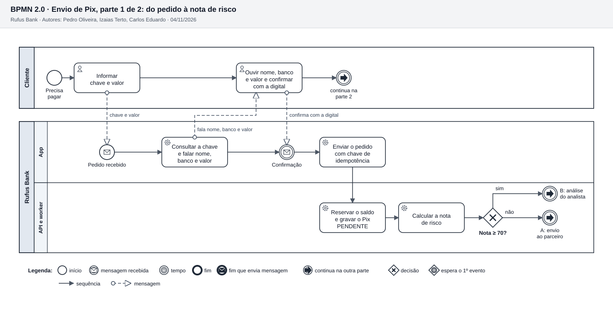

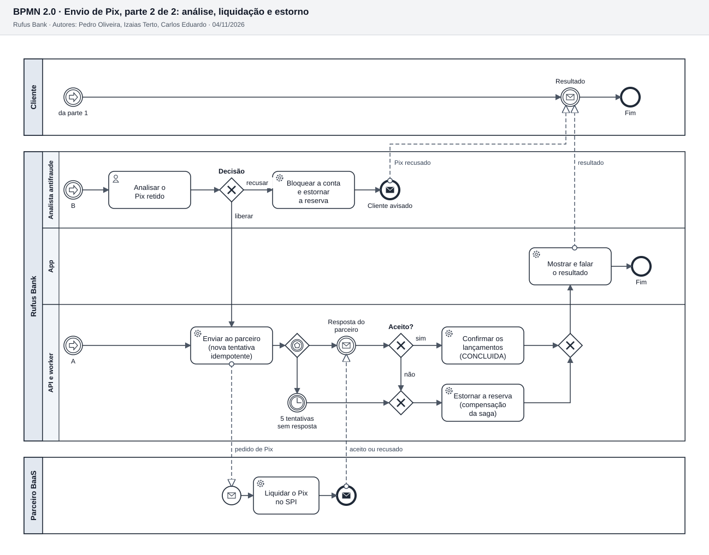

**Como ler.**
- **Parte 1.** O cliente informa a chave e o valor. O app consulta a chave e fala nome, banco e valor (RF009); o cliente confirma com a digital. A API reserva o saldo, grava o Pix como PENDENTE e calcula a nota de risco. O gateway "Nota ≥ 70?" decide o caminho: **não** segue pelo link **A** (envio ao parceiro); **sim** segue pelo link **B** (análise humana, RF026).
- **Parte 2, raia do analista** (link B). O analista analisa o Pix retido e decide. **Liberar** leva ao envio. **Recusar** bloqueia a conta e estorna a reserva; o fim com envelope avisa o cliente (RF027).
- **Parte 2, envio** (link A). A API envia ao parceiro com nova tentativa idempotente. O **gateway baseado em evento** espera o que vier primeiro: a **resposta do parceiro** (mensagem) ou **5 tentativas sem resposta** (tempo). Aceito confirma os lançamentos (CONCLUIDA). Recusado ou sem resposta leva à **compensação da saga**: o estorno da reserva. É o mesmo comportamento da sequência de erro crítico (seção 5) e do ADR-008.
- O resultado volta ao app, que mostra e fala o desfecho ao cliente.

### Processo 2 · Abertura de conta de menor com aceite do responsável

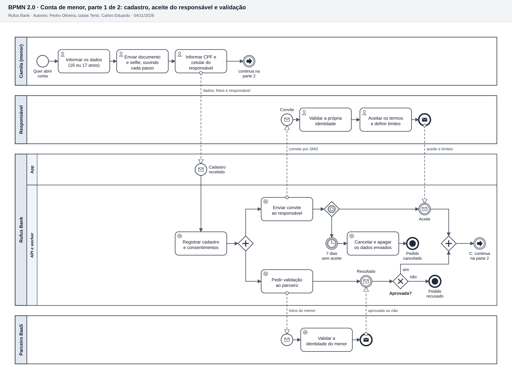

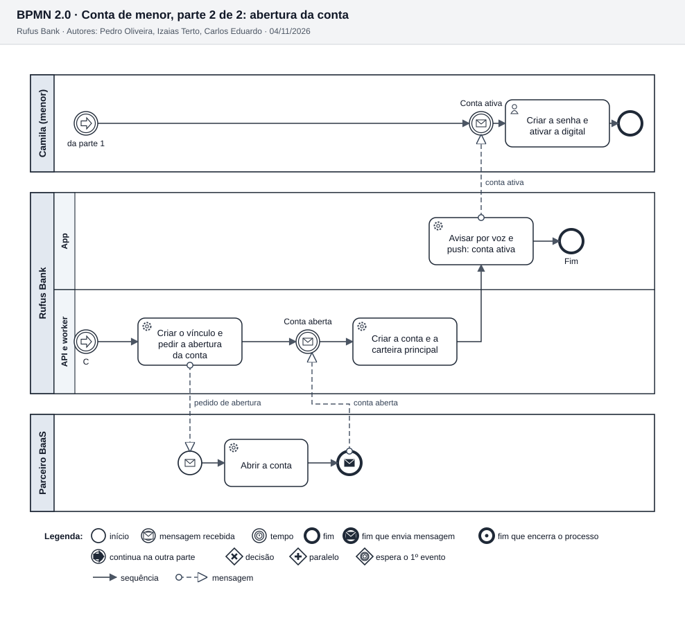

**Como ler.**
- **Parte 1.** A Camila informa os dados, envia documento e selfie ouvindo cada passo e informa o CPF e o celular do responsável. A API registra o cadastro e os consentimentos e abre um **gateway paralelo** (+) com dois caminhos ao mesmo tempo:
  - **convite ao responsável:** o convite vai por SMS ao responsável, que valida a própria identidade, aceita os termos e define os limites. O gateway baseado em evento espera o **aceite** ou o **prazo de 7 dias** (evento de tempo, US09). Se o prazo vence, o pedido é cancelado e os dados enviados são apagados (LGPD), com um fim que **encerra o processo inteiro**;
  - **validação do menor:** o parceiro valida a identidade. Se for recusada, também encerra o processo.
- O **gateway paralelo de junção** só segue quando os dois caminhos terminaram bem. Os fins que encerram o processo evitam que a junção fique esperando para sempre um caminho que já falhou, um erro comum de modelagem.
- **Parte 2** (link C). A API cria o vínculo com os limites e pede a abertura da conta ao parceiro. Com a conta aberta, cria a conta e a carteira principal no razão, avisa por voz e push, e a Camila cria a senha e ativa a digital.

