# 5.2 Modelo conceitual (ER)

Todas as entidades do domínio e como se relacionam, sem atributos. Os nomes vêm do [modelo de domínio](../bloco-3-arquitetura/05-modelo-de-dominio.md).

Para caber legível, o modelo está em duas partes. Cliente, Conta, Transação, Funcionário e Pedido de aprovação aparecem nas duas, para mostrar a ligação.

Fontes: [diagramas/conceitual-1-pessoas-e-atendimento.mmd](diagramas/conceitual-1-pessoas-e-atendimento.mmd) e [diagramas/conceitual-2-dinheiro.mmd](diagramas/conceitual-2-dinheiro.mmd). Notação pé de galinha: `||` exatamente um, `o|` zero ou um, `|{` um ou muitos, `o{` zero ou muitos.

## Como ler o diagrama

O diagrama tem três centros:

1. **CLIENTE**, à esquerda: tudo que é da pessoa. Ela tem uma credencial, usa dispositivos (só um ativo), concede consentimentos, indica contatos de confiança, cadastra lembretes e possui no máximo uma conta. O vínculo com responsável aparece duas vezes porque o mesmo cliente pode ser o **menor** (zero ou um vínculo) ou o **responsável** (zero ou muitos, um pai com vários filhos).
2. **CONTA e TRANSACAO**, no meio: a conta se divide em uma ou mais carteiras e movimenta transações. Cada transação **gera 2 ou mais lançamentos** (partidas dobradas, ADR-007) e "pode ser" um dos quatro subtipos (Pix enviado, Pix recebido, boleto, movimento de meta).
3. **FUNCIONARIO**, embaixo à esquerda: decide análises de risco, atende chamados e deixa registros de auditoria. Nas duas primeiras a participação do funcionário é opcional (`|o`), porque um Pix pode ser liberado automaticamente e um chamado pode estar aberto sem atendente.

## Cardinalidades que merecem explicação

| Relação | Cardinalidade | Por quê |
| --- | --- | --- |
| CLIENTE possui CONTA | 1 para 0..1 | O cliente existe antes da conta (cadastro em análise, US01). Depois de aprovado, uma conta por cliente no MVP |
| CONTA divide em CARTEIRA | 1 para 1..N | Toda conta nasce com a carteira principal; cada meta acrescenta uma |
| META guarda em CARTEIRA | 1 para 1 | A carteira da meta nasce com a meta (composição) |
| TRANSACAO gera LANCAMENTO | 1 para 2..N | O mínimo de 2 é garantido pelo gatilho do banco |
| TRANSACAO pode ser PIX_ENVIO | 1 para 0..1 | Generalização: cada transação tem exatamente um subtipo, indicado por `tipo` |
| TRANSACAO avaliada por ANALISE_RISCO | 1 para 0..1 | Só o Pix enviado passa pelo antifraude |
| TRANSACAO aguarda PEDIDO_APROVACAO | 1 para 0..1 | Só a transação do menor acima do limite gera pedido |
| CHAMADO contém MENSAGEM_CHAMADO | 1 para 1..N | O chamado abre com a primeira mensagem |

`OUTBOX_EVENTO` aparece solta de propósito: ela guarda eventos de qualquer agregado (`agregado_id`), sem chave estrangeira, porque o evento pode vir de transação, conta, vínculo ou chamado (ADR-008).
