# 5.3 Modelo lógico

27 tabelas no esquema `rufus`, com atributos, tipos, chaves primárias (PK), chaves estrangeiras (FK), chaves únicas (UK) e índices. Para caber legível, o modelo está em três diagramas por área. Os três são **gerados do catálogo do banco real** pelo mesmo script do dicionário de dados, então o desenho não diverge do SQL.

## Diagramas

Tabelas de outra área aparecem só com a chave (`id`), para mostrar a ligação. O tipo `char64` no desenho é `char(64)` no banco (o Mermaid não aceita parênteses).

## Tabelas por módulo

| Módulo | Tabelas |
| --- | --- |
| identidade | cliente, dispositivo, credencial, sessao_renovacao, consentimento |
| contas | conta, carteira, lancamento, saldo_fechamento_diario |
| pagamentos | transacao, pix_envio, pix_recebimento, pagamento_boleto, movimento_meta, chave_pix, meta |
| familia | vinculo_responsavel, pedido_aprovacao, contato_confianca |
| antifraude | analise_risco |
| atendimento | chamado, mensagem_chamado |
| backoffice | funcionario, registro_auditoria |
| notificacao | notificacao, outbox_evento, lembrete_conta |

## Decisões de tipo

| Decisão | Por quê |
| --- | --- |
| Dinheiro em `bigint` de centavos | Sem erro de arredondamento de ponto flutuante. `bigint` vai até 92 quatrilhões de centavos. Bate com o ADR-004 (dinheiro como inteiro no TypeScript) |
| Chave `uuid` com `gen_random_uuid()` | O app e o worker podem gerar a chave antes de gravar, e o identificador não revela quantos clientes existem |
| `bigint GENERATED ALWAYS AS IDENTITY` em `registro_auditoria` e `outbox_evento` | Tabelas só de inserção com volume alto, onde a ordem de chegada importa. Mais compacto que `uuid` |
| `timestamptz` em todas as datas com hora | Grava em UTC e converte para o horário de Brasília na exibição. Evita erro no horário do Pix noturno (RF019) |
| `text` com `CHECK ... IN (...)` para os estados | Mais simples de evoluir que `ENUM` do PostgreSQL: incluir um estado novo é trocar a restrição, sem bloquear a tabela inteira |
| `bytea` nos campos cifrados | Guarda o texto cifrado pela aplicação (AES-256-GCM), ver [estratégia](05-estrategia.md) |
| `char(64)` em `cpf_hash` e `hash_token` | Tamanho fixo do SHA-256 em hexadecimal, conferido por `CHECK` |

## Índices justificados

Além das PKs e UKs (que já criam índice), cada índice abaixo existe para uma consulta ou regra específica.

| Índice | Tabela (colunas) | Consulta ou regra que atende |
| --- | --- | --- |
| `ux_dispositivo_um_ativo_por_cliente` | dispositivo (cliente_id) WHERE ativo | **Regra RF005**: no máximo 1 celular ativo. Único e parcial: aparelhos antigos não contam |
| `ix_sessao_dispositivo_validas` | sessao_renovacao (dispositivo_id) WHERE revogada_em IS NULL | Revogar todas as sessões na troca de aparelho (US03) sem varrer as revogadas |
| `ux_funcionario_email` | funcionario (lower(email)) | Login do painel (RF030) e e-mail único sem diferenciar maiúsculas |
| `ix_auditoria_entidade` | registro_auditoria (entidade, entidade_id, ocorrido_em DESC) | "Quem consultou este cliente?" em fiscalização ou pedido do titular (RNF14) |
| `ix_auditoria_funcionario` | registro_auditoria (funcionario_id, ocorrido_em DESC) | "O que este funcionário fez?" em investigação interna |
| `ux_carteira_principal_por_conta` | carteira (conta_id) WHERE tipo = 'PRINCIPAL' | **Regra**: uma carteira principal por conta |
| `ux_carteira_tecnica_unica` | carteira (tipo) WHERE conta_id IS NULL | **Regra**: uma carteira de liquidação de cada tipo no sistema |
| `ix_carteira_conta` | carteira (conta_id) | Listar as carteiras (principal e metas) da conta na tela inicial |
| `ux_transacao_idempotencia` | transacao (conta_id, chave_idempotencia), declarado como restrição UNIQUE | **Regra RNF11**: o mesmo pedido repetido não cria um segundo Pix. É a consulta feita a cada `POST /pix/envios` |
| `ix_transacao_extrato` | transacao (conta_id, criada_em DESC, id DESC) | Extrato paginado por cursor, mais recentes primeiro (`GET /contas/me/extrato`, **RNF01**) |
| `ix_transacao_pendentes` | transacao (status, criada_em) WHERE status IN ('PENDENTE','RETIDA','ENVIADA') | Worker que reprocessa Pix sem resposta do parceiro e conciliação. Parcial: as concluídas, que são quase todas, ficam fora |
| `ix_lancamento_carteira` | lancamento (carteira_id, criado_em) | **Saldo** (soma depois do último fechamento) e fechamento diário (**RNF01**) |
| `ix_lancamento_transacao` | lancamento (transacao_id) | O gatilho de partidas dobradas soma os lançamentos da transação a cada inserção |
| `ux_chave_pix_valor_ativa` | chave_pix (valor) WHERE status = 'ATIVA' | **Regra**: chave ativa única. Depois de excluída pode ser cadastrada de novo |
| `ix_chave_pix_conta` | chave_pix (conta_id) | Listar as chaves da conta (`GET /pix/chaves`) |
| `ix_meta_conta` | meta (conta_id) WHERE status = 'ATIVA' | Listar as metas ativas (`GET /metas`) |
| `ix_movimento_meta_meta` | movimento_meta (meta_id) | Histórico de uma meta |
| `ix_vinculo_responsavel` | vinculo_responsavel (responsavel_cliente_id) WHERE status = 'ATIVO' | O responsável vê os filhos vinculados e os limites (US10) |
| `ix_pedido_pendente` | pedido_aprovacao (vinculo_id, expira_em) WHERE status = 'PENDENTE' | Pedidos que o responsável precisa decidir e worker que expira os de mais de 24 horas (US18) |
| `ix_contato_confianca_cliente` | contato_confianca (cliente_id) WHERE status = 'ATIVO' | Quem avisar quando sai um Pix fora do padrão (US13) |
| `ix_analise_fila` | analise_risco (resultado, id) WHERE resultado = 'RETIDA' | **Fila do painel antifraude** (`GET /admin/analises`, RF027) |
| `ix_chamado_cliente` | chamado (cliente_id, aberto_em DESC) | Histórico de chamados do cliente para o atendente (US15) |
| `ix_chamado_fila` | chamado (status, aberto_em) WHERE status <> 'RESOLVIDO' | Fila do SAC (`GET /admin/chamados`) |
| `ix_mensagem_chamado` | mensagem_chamado (chamado_id, enviada_em) | Conversa do chamado em ordem |
| `ix_notificacao_cliente` | notificacao (cliente_id, criada_em DESC) | Últimas notificações do cliente |
| `ix_outbox_pendentes` | outbox_evento (proxima_tentativa_em) WHERE processado_em IS NULL | **Worker do outbox** (ADR-008): busca só os pendentes. Parcial: a tabela cresce, mas o índice fica pequeno |
| `ix_lembrete_dia` | lembrete_conta (dia_vencimento) WHERE ativo | Job diário que acha os lembretes de daqui a 3 dias (US23) |

O que **não** indexamos de propósito: colunas de baixa seletividade sozinhas (como `status` ou `tipo` sem outra coluna) e campos que nunca aparecem em `WHERE` (como `nome_recebedor`). Cada índice custa espaço e deixa a escrita mais lenta, e o Rufus escreve muito no razão.

O detalhe de cada coluna (tipo, nulo, padrão, restrição, descrição e LGPD) está no [dicionário de dados](04-dicionario-de-dados.md).
