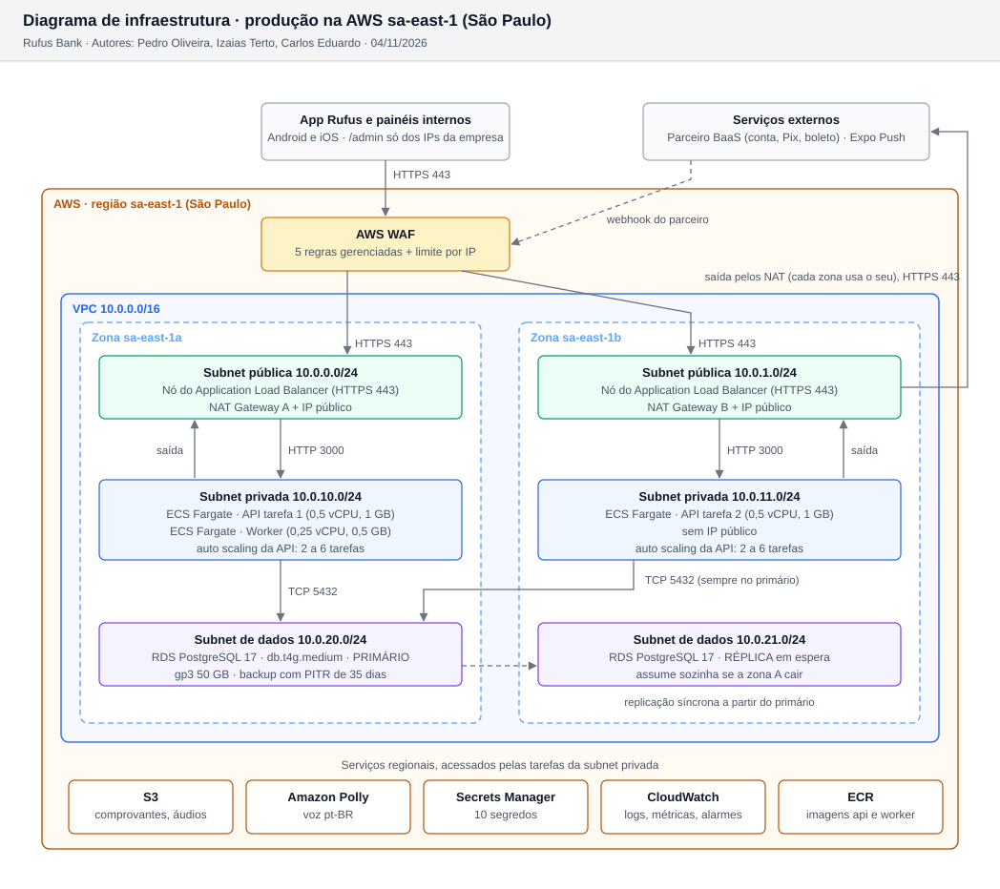

# 6.1 Diagrama de infraestrutura e custo por ambiente

Produção roda na AWS em São Paulo (ADR-013), em **2 zonas de disponibilidade**, com balanceador, 2 tarefas da API, banco Multi-AZ e 1 NAT por zona. Esse desenho é o que sustenta os 99,9% do RNF03: se uma zona inteira cair, a outra continua atendendo e o banco troca para a réplica sozinho.

Fonte do diagrama: [diagramas/infra-producao.svg.py](diagramas/infra-producao.svg.py), gerado por `ferramentas/diagramas/gerar.py`.

## Como ler o diagrama

| Camada | O que tem | Por quê |
| --- | --- | --- |
| Borda | AWS WAF na frente do balanceador | Bloqueia ataques comuns (injeção, robôs) e limita requisições por IP antes de chegar à API (R02). O caminho `/admin` só aceita os IPs da empresa (ADR-012) |
| Subnet pública (1 por zona) | Nós do Application Load Balancer e NAT Gateway | O ALB termina o HTTPS (porta 443) e distribui entre as zonas. O NAT é a única saída para a internet das tarefas, que não têm IP público |
| Subnet privada (1 por zona) | Tarefas do ECS Fargate: API e worker | Sem IP público: só o ALB chega nelas, na porta 3000 |
| Subnet de dados (1 por zona) | RDS PostgreSQL 17 primário na zona A, réplica síncrona na zona B | Só as subnets privadas chegam na porta 5432. Nenhum acesso da internet |
| Serviços regionais | S3, Polly, Secrets Manager, CloudWatch, ECR | Usados pelas tarefas; não ficam dentro da VPC |

Regras de rede (security groups):

| Origem | Destino | Porta | Regra |
| --- | --- | --- | --- |
| Internet | ALB | 443 (e 80 só para redirecionar para 443) | Permitido, passando pelo WAF |
| ALB | Tarefas da API | 3000 | Só o security group do ALB |
| Tarefas (API e worker) | RDS | 5432 | Só o security group das tarefas |
| Tarefas | Internet (parceiro BaaS, Expo) | 443 | Saída pelo NAT da própria zona |
| Qualquer outro | Qualquer outro | | Negado |

## Ambientes

| Ambiente | Onde | Diferença para produção |
| --- | --- | --- |
| Desenvolvimento | Máquina do dev, Docker Compose (`codigo/docker-compose.yml`) | Tudo local, parceiro BaaS e voz com adaptador falso (ADR-002) |
| Homologação | AWS sa-east-1, conta separada | 1 zona, 1 tarefa da API, banco db.t4g.small sem réplica, 1 NAT. Mesmo código e mesmo Terraform com outros parâmetros |
| Produção | AWS sa-east-1 | O diagrama acima |

## Custo mensal real por ambiente

Valores de [ferramentas/custo-infra/custo-gerado.md](../ferramentas/custo-infra/custo-gerado.md), calculados pelo script `custo_infra.py` com a tabela oficial de preços da AWS e a PTAX de 04/11/2026 (R$ 5,4778). A tabela item a item está lá.

| Ambiente | USD por mês | R$ por mês |
| --- | --- | --- |
| Produção | 689,91 | 3.779,18 |
| Homologação | 207,50 | 1.136,64 |
| Serviços fora da AWS (Expo EAS, GitHub, domínio, lojas) | 94,86 | 519,62 |
| Desenvolvimento | 0,00 | 0,00 |
| **Total** | **992,27** | **5.435,43** |

Onde está o dinheiro de produção: banco Multi-AZ com disco, backup e snapshots (US$ 284,40), os 2 NAT Gateways (US$ 137,64) e os containers (US$ 62,00). O NAT duplicado e o Multi-AZ são o preço da disponibilidade: com 1 NAT só, uma falha na zona A cortaria a comunicação com o parceiro BaaS também na zona B.

## E se a demanda triplicar?

A API escala de 2 para até 6 tarefas sozinha (auto scaling por CPU acima de 60% e por requisições por tarefa). O banco é o limite: o próximo passo é trocar o db.t4g.medium por um db.m7g.large Multi-AZ, que a tabela da AWS em São Paulo cobra US$ 0,442 por hora, e só depois considerar réplica de leitura para o extrato. Nada muda no código.
