# 7.1 WBS (Work Breakdown Structure)

A WBS divide o MVP em **6 grupos de entrega**, 25 pacotes de trabalho e, no 4º nível, as 24 histórias do Bloco 2 e as 20 tarefas técnicas. São 4 níveis de decomposição; o enunciado pede no mínimo 3.

Fonte do diagrama: [diagramas/wbs.mmd](diagramas/wbs.mmd). O diagrama mostra os níveis 1 a 3. O nível 4 está na tabela abaixo.

## Nível 4: o que tem dentro de cada pacote

Os pontos são os mesmos das histórias (Bloco 2) e das tarefas técnicas ([02-estimativas.md](02-estimativas.md)).

| Nível 2 | Nível 3 | Nível 4 (itens) | SP |
| --- | --- | --- | --- |
| 1.1 Gestão | 1.1.1 Backlog e planejamento | Refinamento semanal, priorização MoSCoW, replanejamento depois do sprint 2 | Sem SP |
| | 1.1.2 Cerimônias Scrum | Planning, daily, review e retrospectiva de cada sprint ([bloco-9-qualidade/06-metodologia.md](../bloco-9-qualidade/06-metodologia.md)) | Sem SP |
| | 1.1.3 Riscos e contrato BaaS | Revisão quinzenal da matriz de riscos, negociação com 2 parceiros (R04) | Sem SP |
| 1.2 Produto | 1.2.1 Conta e acesso | US01 Abrir conta, US02 Entrar com digital, US03 Trocar de celular, US17 Encerrar conta e baixar dados | 23 |
| | 1.2.2 Dinheiro do dia a dia | US04 Ouvir saldo, US05 Receber por QR Code, US06 Enviar Pix, US07 Pix sem duplicar, US08 Pagar boleto, US21 Comprovante | 32 |
| | 1.2.3 Proteção contra golpe | US11 Limite para destinatário novo e à noite, US12 Bloquear tudo, US13 Contato de confiança, US16 Analisar Pix retido | 17 |
| | 1.2.4 Família | US09 Conta da Camila, US10 Limite do responsável, US18 Pedir aprovação | 16 |
| | 1.2.5 Metas e educação | US19 Meta do notebook, US23 Lembrete de conta, US24 Dicas em áudio | 10 |
| | 1.2.6 Atendimento e avisos | US14 Chat no app, US15 Painel do SAC, US20 Aviso de movimentação | 13 |
| | 1.2.7 Backoffice | US22 Cadastrar funcionário com papel | 3 |
| 1.3 Plataforma técnica | 1.3.1 Infraestrutura como código | T02 Terraform de rede, T03 Terraform de containers e banco | 16 |
| | 1.3.2 Pipeline CI/CD | T04 CI, T05 CD | 10 |
| | 1.3.3 Base da API, app e painel | T01 Repositório e padrões, T06 Esqueleto da API, T12 Esqueleto do app, T13 Esqueleto do painel | 21 |
| | 1.3.4 Razão contábil e eventos | T07 Razão com partidas dobradas, T08 Outbox e worker | 13 |
| 1.4 Integrações | 1.4.1 Parceiro BaaS | T09 Porta e adaptador falso, T10 Adaptador real e webhooks | 13 |
| | 1.4.2 Voz | T11 Polly, cache e voz do celular | 5 |
| | 1.4.3 Conciliação | T18 Conciliação diária | 5 |
| 1.5 Qualidade | 1.5.1 Testes automatizados | Dentro da Definition of Done de cada item, sem SP próprio ([bloco-9-qualidade/02-estrategia-de-testes.md](../bloco-9-qualidade/02-estrategia-de-testes.md)) | Sem SP |
| | 1.5.2 Segurança | T15 Revisão OWASP e teste de invasão | 8 |
| | 1.5.3 Desempenho | T16 Teste de carga k6 | 3 |
| | 1.5.4 Acessibilidade e testes com usuários | T17 Auditoria WCAG. Os testes de uso de cada sprint estão na DoD | 5 |
| | 1.5.5 Observabilidade e backup | T14 Painéis e alarmes, T20 Teste de restauração | 5 |
| 1.6 Implantação | 1.6.1 Publicação nas lojas | T19 Contas e revisão Apple e Google | 3 |
| | 1.6.2 Beta fechado | 50 pessoas do perfil das personas no sprint 8 | Reserva do sprint 8 |
| | 1.6.3 Lançamento e treino do SAC | Liberação gradual e treino do SAC com os golpes mais comuns | Reserva do sprint 8 |
| **Total** | | 24 histórias e 20 tarefas técnicas | **221** |

Conferência: Produto soma 114 SP (igual ao Bloco 2) e Plataforma, Integrações, Qualidade e Implantação somam 107 SP (igual às tarefas técnicas do item 7.2).
