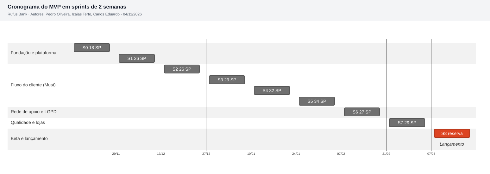

# 7.2 Estimativa de esforço e cronograma

> Arquivo gerado por `ferramentas/planejamento.py`. Não editar à mão: mude o plano no script e rode de novo.

O MVP soma **221 story points**: 114 das 24 histórias do Bloco 2 e 107 de tarefas técnicas. Com a equipe do item 7.3, isso cabe em **9 sprints de 2 semanas**, de 16/11/2026 a 19/03/2027 (18 semanas). O último sprint não tem item novo: é a reserva para o beta fechado e as correções.

## Velocidade da equipe

- Quem produz story points: 2 devs de back-end, 2 devs mobile e o DevOps em meio período, **4,5 pessoas equivalentes**. PO, QA e UX não pontuam: o trabalho deles está dentro da Definition of Done de cada história.
- Velocidade de referência: **34 SP por sprint** com a equipe completa e 10 dias úteis, cerca de 7,6 pontos por pessoa por sprint. A referência de tamanho é a US13 = 3 pontos (Bloco 2).
- Rampa: o sprint 0 rende 60% (montagem do ambiente, equipe nova) e o sprint 1 rende 80%.
- Feriados e pontos facultativos reduzem a capacidade na proporção dos dias úteis perdidos.
- A velocidade é uma hipótese. Depois do sprint 2 ela é recalculada pela média dos sprints anteriores e o plano é refeito.

## Sprints

| Sprint | Período | Dias úteis | Capacidade (SP) | Planejado (SP) | Uso | Objetivo |
| --- | --- | --- | --- | --- | --- | --- |
| 0 | 16/11/2026 a 27/11/2026 | 9 | 18,4 | 18 | 98% | Fundação: repositório, pipeline de CI, esqueleto da API e parceiro falso |
| 1 | 30/11/2026 a 11/12/2026 | 10 | 27,2 | 26 | 96% | Antônio entra com a digital num app que fala |
| 2 | 14/12/2026 a 25/12/2026 | 9 | 30,6 | 26 | 85% | Antônio abre a conta sozinho e ouve o saldo |
| 3 | 28/12/2026 a 08/01/2027 | 9 | 30,6 | 29 | 95% | Enviar e receber Pix sem duplicar, com infraestrutura de homologação e produção |
| 4 | 11/01/2027 a 22/01/2027 | 10 | 34,0 | 32 | 94% | Boleto, proteção contra golpe e primeira fila do antifraude |
| 5 | 25/01/2027 a 05/02/2027 | 10 | 34,0 | 34 | 100% | Conta da Camila e atendimento humano, já com o parceiro real |
| 6 | 08/02/2027 a 19/02/2027 | 8 | 27,2 | 27 | 99% | Rede de apoio (contato de confiança, aprovação) e direitos LGPD |
| 7 | 22/02/2027 a 05/03/2027 | 10 | 34,0 | 29 | 85% | Segurança, carga, acessibilidade e publicação nas lojas |
| 8 | 08/03/2027 a 19/03/2027 | 10 | 34,0 | 0 | reserva | Beta fechado com 50 pessoas do perfil, correções e lançamento |
| **Total** | | | **270,0** | **221** | | |

Nos sprints com itens (0 a 7), a capacidade é de 236,0 SP para 221 planejados: uso de 94%, com folga para imprevisto. O sprint 8 inteiro é reserva.

Feriados considerados: 20/11/2026 Dia da Consciência Negra (feriado nacional); 25/12/2026 Natal; 01/01/2027 Confraternização Universal; 08/02/2027 Carnaval (segunda, ponto facultativo); 09/02/2027 Carnaval (terça, ponto facultativo); 26/03/2027 Sexta-feira Santa.

## O que entra em cada sprint

Ordem: primeiro o que destrava os outros (plataforma, razão contábil, parceiro falso), depois os Must na ordem do fluxo do cliente, depois os Should e por fim os Could. Todo Must termina até o sprint 6.

### Sprint 0 · 16/11 a 27/11/2026 · Fundação: repositório, pipeline de CI, esqueleto da API e parceiro falso

| Item | Descrição | Tipo | Prioridade | SP |
| --- | --- | --- | --- | --- |
| T01 | Repositório, padrões de código, lint e estrutura de módulos | Plataforma | Técnica | 3 |
| T06 | Esqueleto da API NestJS: módulos, configuração, /health, log pino com correlação | Plataforma | Técnica | 5 |
| T04 | Pipeline de CI: lint, testes, build e varredura de segurança | Plataforma | Técnica | 5 |
| T09 | Porta bancária e adaptador falso do parceiro BaaS | Integrações | Técnica | 5 |
| | **Total** | | | **18** |

### Sprint 1 · 30/11 a 11/12/2026 · Antônio entra com a digital num app que fala

| Item | Descrição | Tipo | Prioridade | SP |
| --- | --- | --- | --- | --- |
| T12 | Esqueleto do app Expo: navegação, tema acessível, botão Ouvir, cliente gerado do OpenAPI | Plataforma | Técnica | 8 |
| T07 | Migrações e razão contábil: carteiras, lançamentos e gatilho de soma zero | Plataforma | Técnica | 8 |
| US02 | Antônio: Entrar com a digital | Produto | Must | 5 |
| T11 | Porta de voz: Amazon Polly, cache no S3 e voz do celular sem internet | Integrações | Técnica | 5 |
| | **Total** | | | **26** |

### Sprint 2 · 14/12 a 25/12/2026 · Antônio abre a conta sozinho e ouve o saldo

| Item | Descrição | Tipo | Prioridade | SP |
| --- | --- | --- | --- | --- |
| US01 | Antônio: Abrir a conta ouvindo cada passo | Produto | Must | 8 |
| US04 | Antônio: Ouvir o saldo e o extrato | Produto | Must | 5 |
| T08 | Outbox transacional e worker com SKIP LOCKED e nova tentativa | Plataforma | Técnica | 5 |
| T02 | Terraform: VPC, subnets, NAT, ALB e WAF | Plataforma | Técnica | 8 |
| | **Total** | | | **26** |

### Sprint 3 · 28/12 a 08/01/2027 · Enviar e receber Pix sem duplicar, com infraestrutura de homologação e produção

| Item | Descrição | Tipo | Prioridade | SP |
| --- | --- | --- | --- | --- |
| T03 | Terraform: ECS Fargate, RDS Multi-AZ, Secrets Manager e ECR (homologação e produção) | Plataforma | Técnica | 8 |
| T05 | Pipeline de CD: homologação, smoke test, aprovação e produção | Plataforma | Técnica | 5 |
| US06 | Dona Marlene: Enviar Pix ouvindo para quem vai | Produto | Must | 8 |
| US07 | Antônio: Não mandar Pix em dobro | Produto | Must | 3 |
| US05 | Antônio: Receber a diária por QR Code | Produto | Must | 5 |
| | **Total** | | | **29** |

### Sprint 4 · 11/01 a 22/01/2027 · Boleto, proteção contra golpe e primeira fila do antifraude

| Item | Descrição | Tipo | Prioridade | SP |
| --- | --- | --- | --- | --- |
| US08 | Dona Marlene: Pagar boleto pela câmera | Produto | Must | 8 |
| US11 | Antônio: Ter limite menor com destinatário novo e à noite | Produto | Must | 3 |
| US12 | Dona Marlene: Bloquear tudo na hora | Produto | Must | 3 |
| US03 | Dona Marlene: Trocar de celular com selfie | Produto | Must | 5 |
| T13 | Esqueleto do painel interno (React e Vite) com login e TOTP | Plataforma | Técnica | 5 |
| US16 | Analista antifraude: Analisar Pix retido | Produto | Must | 8 |
| | **Total** | | | **32** |

### Sprint 5 · 25/01 a 05/02/2027 · Conta da Camila e atendimento humano, já com o parceiro real

| Item | Descrição | Tipo | Prioridade | SP |
| --- | --- | --- | --- | --- |
| T10 | Adaptador real do parceiro BaaS (sandbox) e webhooks com HMAC | Integrações | Técnica | 8 |
| US09 | Camila: Abrir conta com aceite do pai | Produto | Must | 8 |
| US10 | Responsável da Camila: Definir limite da conta da filha | Produto | Must | 3 |
| US14 | Antônio: Falar com uma pessoa pelo chat do app | Produto | Must | 5 |
| US15 | Atendente do SAC: Responder chamado vendo o histórico | Produto | Must | 5 |
| T18 | Conciliação diária com o parceiro (RNF11) | Integrações | Técnica | 5 |
| | **Total** | | | **34** |

### Sprint 6 · 08/02 a 19/02/2027 · Rede de apoio (contato de confiança, aprovação) e direitos LGPD

| Item | Descrição | Tipo | Prioridade | SP |
| --- | --- | --- | --- | --- |
| US17 | Antônio: Encerrar a conta e baixar meus dados | Produto | Must | 5 |
| US13 | Dona Marlene: Cadastrar o neto como contato de confiança | Produto | Should | 3 |
| US18 | Camila: Pedir aprovação acima do limite | Produto | Should | 5 |
| US20 | Camila: Receber aviso de cada movimentação | Produto | Should | 3 |
| US21 | Dona Marlene: Ouvir e compartilhar o comprovante | Produto | Should | 3 |
| US22 | Administrador: Cadastrar funcionário com papel | Produto | Should | 3 |
| US19 | Camila: Criar a meta do notebook | Produto | Should | 5 |
| | **Total** | | | **27** |

### Sprint 7 · 22/02 a 05/03/2027 · Segurança, carga, acessibilidade e publicação nas lojas

| Item | Descrição | Tipo | Prioridade | SP |
| --- | --- | --- | --- | --- |
| T15 | Segurança: revisão OWASP, teste de invasão externo e correções | Qualidade | Técnica | 8 |
| T16 | Teste de carga com k6 (RNF04) | Qualidade | Técnica | 3 |
| T17 | Auditoria de acessibilidade WCAG 2.2 AA (RNF09) | Qualidade | Técnica | 5 |
| T20 | Teste de restauração de backup (RNF12) | Qualidade | Técnica | 2 |
| T14 | Observabilidade: painéis e alarmes do RNF01, RNF03 e RNF13 | Qualidade | Técnica | 3 |
| US23 | Dona Marlene: Lembrete de conta a vencer | Produto | Could | 3 |
| US24 | Camila: Ouvir dicas de dinheiro | Produto | Could | 2 |
| T19 | Publicação nas lojas: contas, revisão da Apple e do Google | Implantação | Técnica | 3 |
| | **Total** | | | **29** |

### Sprint 8 · 08/03 a 19/03/2027 · Beta fechado com 50 pessoas do perfil, correções e lançamento

Sem item novo. Beta fechado com 50 pessoas do perfil das personas, correção do que aparecer, lançamento controlado.

## Tarefas técnicas

| ID | Tarefa | Grupo da WBS | SP | Sprint |
| --- | --- | --- | --- | --- |
| T01 | Repositório, padrões de código, lint e estrutura de módulos | Plataforma | 3 | 0 |
| T02 | Terraform: VPC, subnets, NAT, ALB e WAF | Plataforma | 8 | 2 |
| T03 | Terraform: ECS Fargate, RDS Multi-AZ, Secrets Manager e ECR (homologação e produção) | Plataforma | 8 | 3 |
| T04 | Pipeline de CI: lint, testes, build e varredura de segurança | Plataforma | 5 | 0 |
| T05 | Pipeline de CD: homologação, smoke test, aprovação e produção | Plataforma | 5 | 3 |
| T06 | Esqueleto da API NestJS: módulos, configuração, /health, log pino com correlação | Plataforma | 5 | 0 |
| T07 | Migrações e razão contábil: carteiras, lançamentos e gatilho de soma zero | Plataforma | 8 | 1 |
| T08 | Outbox transacional e worker com SKIP LOCKED e nova tentativa | Plataforma | 5 | 2 |
| T09 | Porta bancária e adaptador falso do parceiro BaaS | Integrações | 5 | 0 |
| T10 | Adaptador real do parceiro BaaS (sandbox) e webhooks com HMAC | Integrações | 8 | 5 |
| T11 | Porta de voz: Amazon Polly, cache no S3 e voz do celular sem internet | Integrações | 5 | 1 |
| T12 | Esqueleto do app Expo: navegação, tema acessível, botão Ouvir, cliente gerado do OpenAPI | Plataforma | 8 | 1 |
| T13 | Esqueleto do painel interno (React e Vite) com login e TOTP | Plataforma | 5 | 4 |
| T14 | Observabilidade: painéis e alarmes do RNF01, RNF03 e RNF13 | Qualidade | 3 | 7 |
| T15 | Segurança: revisão OWASP, teste de invasão externo e correções | Qualidade | 8 | 7 |
| T16 | Teste de carga com k6 (RNF04) | Qualidade | 3 | 7 |
| T17 | Auditoria de acessibilidade WCAG 2.2 AA (RNF09) | Qualidade | 5 | 7 |
| T18 | Conciliação diária com o parceiro (RNF11) | Integrações | 5 | 5 |
| T19 | Publicação nas lojas: contas, revisão da Apple e do Google | Implantação | 3 | 7 |
| T20 | Teste de restauração de backup (RNF12) | Qualidade | 2 | 7 |
| | **Total** | | **107** | |

## Histórias por prioridade

| Prioridade | Histórias | SP | Último sprint |
| --- | --- | --- | --- |
| Must | 16 | 87 | 6 |
| Should | 6 | 22 | 6 |
| Could | 2 | 5 | 7 |
